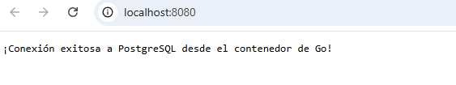
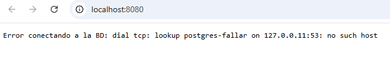

# LAB 7: Dockerfile Multi-Stage y Docker Compose con Base de Datos

```bash
+-----------------------------------------------------------------------------------------+
|                                    Tu Sistema Operativo                                 |
|                               (Linux / Windows / macOS)                                 |
|                                                                                         |
|   +---------------------------------------------------------------------------------+   |
|   |                                  Docker Engine                                  |   |
|   |                                                                                 |   |
|   |   +-----------------------------------+     +-------------------------------+   |   |
|   |   |        Contenedor: App (Go)       |     |   Contenedor: PostgreSQL 15   |   |   |
|   |   |                                   |     |                               |   |   |
|   |   |   [ Alpine Minimal Image: 15MB ]  |     |   [ PostgreSQL Alpine Base ]  |   |   |
|   |   |   - Binario estático compilado    |     |   - Motor relacional activo   |   |   |
|   |   |   - Servidor HTTP en puerto 8080  |     |   - Puerto interno: 5432      |   |   |
|   |   +-----------------+-----------------+     +---------------+---------------+   |   |
|   |                     |                                     |                     |   |
|   |                     +------------ ( Red Interna ) --------+                     |   |
|   |                                  DB_HOST=postgres                               |   |
|   |                                                                                 |   |
|   |   +-------------------------------------------------------------------------+   |   |
|   |   |                             Docker Volume                               |   |   |
|   |   |                       [ lab-07_postgres_data ]                          |   |   |
|   |   |             Persistencia de tablas, registros y datos en disco          |   |   |
|   |   +-------------------------------------------------------------------------+   |   |
|   +---------------------------------------------------------------------------------+   |
|                                                                                         |
|   Puertos expuestos al Host Local:                                                      |
|   - App Web:       http://localhost:8080  <=====>  [ Puerto 8080 : 8080 ]               |   |
|   - Base de Datos: localhost:5432       <=====>  [ Puerto 5432 : 5432 ]               |   |
+-----------------------------------------------------------------------------------------+
```

## Table of contents

- [Ejercicio](#ejercicio)
- [Preguntas](#preguntas)
- [Dockerfile](#dockerfile)
- [Docker Compose](#docker-compose)
- [Verificacion](#verificacion)
- [Author](#author)

## Ejercicio

+ Entramos en el bloque de Contenedores y Orquestación. En este laboratorio construiremos un entorno de desarrollo completo y optimizado desde cero.

+ Objetivos del LAB 7:
    - Dockerfile Multi-Stage: Crear una imagen de Docker optimizada utilizando la técnica de compilación/preparación en etapas (multi-stage build). Esto nos permite reducir drásticamente el tamaño de la imagen final y mejorar la seguridad eliminando herramientas de compilación innecesarias en producción.

    - Docker Compose: Definir un archivo docker-compose.yml que orqueste:
        + El contenedor de nuestra aplicación (construido con el Dockerfile multi-stage).
        + Un contenedor de base de datos (PostgreSQL).
        + Redes internas privadas entre contenedores.
        + Volúmenes persistentes para que los datos de la base de datos no se pierdan al reiniciar el contenedor.
        + Controles de salud (healthcheck) para garantizar que la aplicación no intente conectarse a la base de datos hasta que esta esté lista.

+ Estructura:
```bash
lab-07/
├── app/
│   ├── main.go          # Aplicación web sencilla (en Go o Node.js)
│   └── Dockerfile       # Dockerfile Multi-Stage
├── docker-compose.yml   # Orquestación de App + PostgreSQL + Volúmenes
└── README.md
```

## Preguntas

+ Antes de escribir una sola línea de código, responde a estas 4 preguntas cortas para medir tu punto de partida:
    - Multi-stage Build: ¿Por qué en un Dockerfile multi-stage la imagen final de producción suele pesar ~15-20 MB mientras que la etapa de compilación/build puede pesar más de 800 MB? ¿Qué es lo que nos llevamos de la primera etapa a la segunda?
    > la imagen final se queda solo con lo mínimo, con el ejecutable resultante de la app de la base builder.
    - Docker Compose & Redes: Cuando dos contenedores (ej. app y postgres) están definidos dentro del mismo archivo docker-compose.yml, ¿qué nombre de host (hostname) usa la aplicación en la cadena de conexión a la base de datos para comunicarse con PostgreSQL?
    > app y el contenedor de la base de datos se llamará postgres
    - Persistencia de Datos: Si borras un contenedor de PostgreSQL con docker rm -f, ¿qué ocurre con las tablas y datos creados si no has definido un volumen (volume) en el docker-compose.yml?
    > sin volumenes, la informacion no persiste por lo que se borraría todo lo creado y guardado como info
    - Healthchecks: ¿Para qué sirve la directiva depends_on combinada con condition: service_healthy en Docker Compose a la hora de arrancar la app respecto a la base de datos?
    > para indicar que no se cree la app y la base de datos no está ya creada y saludable

+ La Etapa de Construcción (Builder): Para compilar nuestro código escrito en Go, necesitamos descargar el compilador de Go, herramientas de red, librerías de desarrollo... Todo esto hace que esta primera "fábrica" pese más de 800 MB.

+ La Etapa de Ejecución (Final): Una vez que Go ha terminado de compilar el código, se crea un archivo binario (un único archivo ejecutable llamado main). Ese archivo binario ya no necesita el compilador de Go para funcionar; es totalmente autónomo.

+ El truco del Multi-stage (COPY --from=builder): Le decimos a Docker: "Crea una caja gigante temporal para compilar, saca de ahí solo el archivo ejecutable resultante, tíralo todo lo demás a la basura, y mételo en una cajita diminuta y limpia (Alpine) de apenas 15 MB".
> Resultado: Una imagen hiperligera, más rápida de descargar/subir a la nube, y mucho más segura (al no tener herramientas de compilación, si alguien entra al contenedor, tiene menos vectores de ataque).

## Dockerfile

+ Pistas para construirlo:
    - Etapa 1 (builder):
        + Usa la imagen base oficial golang:1.22-alpine (asígna un alias con AS builder).
        + Define un WORKDIR /app.
        + Copia los archivos del código (go.mod, go.sum o main.go).
        + Ejecuta la inicialización de módulos y la compilación: RUN go mod init app && go get [github.com/lib/pq](https://github.com/lib/pq) && CGO_ENABLED=0 GOOS=linux go build -o main .
    - Etapa 2 (final):
        + Usa una imagen ultra ligera de ejecución como alpine:3.19 o incluso scratch.
        + Define WORKDIR /app.
        + Copia únicamente el ejecutable main generado en la etapa anterior desde --from=builder /app/main ..
        + Expón el puerto 8080 (EXPOSE 8080).
        + Define el punto de entrada para ejecutar el binario: CMD ["./main"].

```Dockerfile
# ==========================================
# ETAPA 1: El taller de construcción (Builder)
# ==========================================
# Usamos la imagen oficial pesada de Go para compilar el binario
FROM golang:1.22-alpine AS builder

# Creamos y nos situamos en la carpeta de trabajo dentro del contenedor
WORKDIR /app

# Copiamos los archivos de código fuente a esta carpeta
COPY main.go ./

# Inicializamos los módulos de Go, descargamos el driver de PostgreSQL y compilamos
# - CGO_ENABLED=0 y GOOS=linux aseguran que el binario sea 100% estático para Linux
RUN go mod init app && \
    go get github.com/lib/pq && \
    CGO_ENABLED=0 GOOS=linux go build -o main .

# ==========================================
# ETAPA 2: La imagen final de producción (Ligera)
# ==========================================
# Partimos de una distribución Linux ultra-limpia y segura (Alpine Linux)
FROM alpine:3.19

WORKDIR /app

# MAGIA DEL MULTI-STAGE: Copiamos ÚNICAMENTE el archivo binario 'main' de la etapa anterior
# Descartamos por completo los 800MB del compilador de Go
COPY --from=builder /app/main .

# Exponemos el puerto 8080 donde nuestra app web escuchará peticiones
EXPOSE 8080

# Definimos el comando por defecto al arrancar el contenedor
CMD ["./main"]
```

## Docker compose

```YAML
version: '3.8'

services:
  app:
    build:
      context: ./app
    ports:
      - "8080:8080"
    environment:
      - DB_HOST=postgres
      - DB_PORT=5432
      - DB_USER=mi_usuario
      - DB_PASSWORD=mi_password_segura
      - DB_NAME=mi_base_datos
    depends_on:
      postgres:
        condition: service_healthy

  postgres:
    image: postgres:15-alpine
    environment:
      POSTGRES_USER: mi_usuario
      POSTGRES_PASSWORD: mi_password_segura
      POSTGRES_DB: mi_base_datos
    ports:
      - "5432:5432"
    volumes:
      - postgres_data:/var/lib/postgresql/data
    healthcheck:
      test: ["CMD-SHELL", "pg_isready -U mi_usuario -d mi_base_datos"]
      interval: 5s
      timeout: 5s
      retries: 5

volumes:
  postgres_data:
```
> environment en la app: Le inyectamos las variables (DB_HOST=postgres, etc.) que nuestro código en Go lee con os.Getenv(...) para armar la cadena de conexión. Fíjate que el DB_HOST es exactamente el nombre del servicio de postgres (postgres), aprovechando la red interna que Docker Compose crea automáticamente.

> condition: service_healthy: Obliga a Docker a esperar a que el comando de salud (pg_isready) de la base de datos responda positivamente antes de lanzar el contenedor de la aplicación.


## Verificacion

1. Levantar los contenedores construyendo la imagen multi-stage:

```Bash
docker compose up --build
```

2. Abre otra pestaña en tu terminal y comprueba que ambos contenedores están corriendo:
```Bash
docker ps
```

3. Abre tu navegador o ejecuta un curl para verificar la conexión contra la base de datos:
```Bash
curl http://localhost:8080
```
> (Debería devolverte el texto: ¡Conexión exitosa a PostgreSQL desde el contenedor de Go!)

  

4. Proceso interno:
```bash
✔ Image postgres:15-alpine    Pulled                                                              
✔ Image lab-07-app            Built                                                                             
✔ Network lab-07_default      Created
✔ Volume lab-07_postgres_data Created 
✔ Container lab-07-postgres-1 Created
✔ Container lab-07-app-1      Created
Attaching to app-1, postgres-1
Container lab-07-postgres-1 Waiting 
Container lab-07-postgres-1 Healthy
```

1. Creación de Red y Volumen:
    + Docker Compose creó una red virtual privada exclusiva para este laboratorio (lab-07_default) y el volumen persistente para la base de datos (lab-07_postgres_data).

2. Arranque de la Base de Datos (postgres):
    + Descargó la imagen postgres:15-alpine y puso en marcha el contenedor lab-07-postgres-1.
    + En los primeros segundos viste el estado Waiting. ¿Por qué? Porque PostgreSQL estaba arrancando sus servicios internos y creando los ficheros del sistema.

3. El Healthcheck (El semáforo inteligente):
    + Gracias al bloque healthcheck que incluimos con pg_isready, Docker preguntaba cada pocos segundos a PostgreSQL: ¿Estás listo para aceptar conexiones?
    + En cuanto PostgreSQL respondió afirmativamente, su estado cambió a Healthy (Saludable).

4. Construcción y Arranque de la App (app):
    + Al ver que la base de datos estaba Healthy, Docker liberó el freno de mano del servicio app (gracias al depends_on con condition: service_healthy).
    + Compiló tu aplicación en Go utilizando el multi-stage build (usando el Alpine ligero) y levantó el contenedor lab-07-app-1.

5. Cuando escribimos en el docker-compose.yml la variable de entorno: `DB_HOST=postgres`
    + ¿Cómo sabe la aplicación dónde está la base de datos?: Docker Compose crea automáticamente un DNS interno para la red de ese proyecto. Cada servicio recibe un nombre de host idéntico al nombre con el que lo has bautizado en el YAML. Por tanto, el contenedor de la aplicación puede escribirle directamente a postgres como si fuera una dirección web (http://postgres o postgres:5432), y la red interna de Docker se encarga de traducirlo a la IP real del contenedor de la base de datos de forma totalmente transparente.

6. Vamos a conectar los puntos entre tu main.go y tu docker-compose.yml:
```bash
# docker-compose
environment:
  - DB_HOST=postgres
  - DB_PORT=5432
  - DB_USER=mi_usuario
  - DB_PASSWORD=mi_password_segura
  - DB_NAME=mi_base_datos

# app go
dbHost := os.Getenv("DB_HOST") // Lee "postgres"
dbUser := os.Getenv("DB_USER") // Lee "mi_usuario"
...

# Con esos datos, Go arma la cadena técnica que entiende PostgreSQL:
connStr := fmt.Sprintf("host=%s port=%s user=%s password=%s dbname=%s sslmode=dis
```
> fmt.Sprintf(...): Es una función de Go que sirve para construir cadenas de texto formateadas rellenando los huecos marcados con %s en orden.  
> "host=%s port=%s ...": Es la plantilla de texto que entiende la librería de PostgreSQL (lib/pq). Cada %s se sustituye secuencialmente por la variable que le pasas después.

7. La prueba de fuego (db.Ping()):
    + Cuando ejecutas curl http://localhost:8080, tu navegador o terminal llama al servidor web de Go. En ese preciso instante, la app abre un canal de red con la base de datos (sql.Open) y lanza un paquete de prueba (db.Ping()). Como PostgreSQL estaba arrancado y accesible en la red interna, respondió con un OK, devolviéndote el mensaje de éxito que viste en pantalla.


  
> Si cambiamos por ejemplo dato de DB host, nos da error de conexión. Eso significa que el DNS interno de Docker intentó buscar una máquina llamada postgres-fallar en la red privada, no la encontró por ninguna parte, y por eso el driver de PostgreSQL en Go lanzó un error fatal de red (dial tcp).


## Author
+ Miguel — [GitHub](https://github.com/mamoros-dev) · [LinkedIn](https://www.linkedin.com/in/miguel-amoros-moret/)
