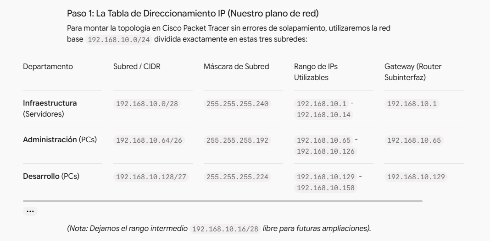
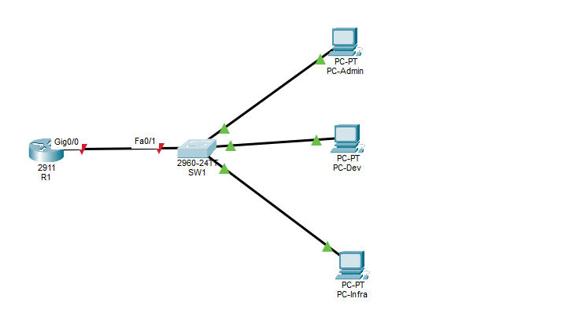
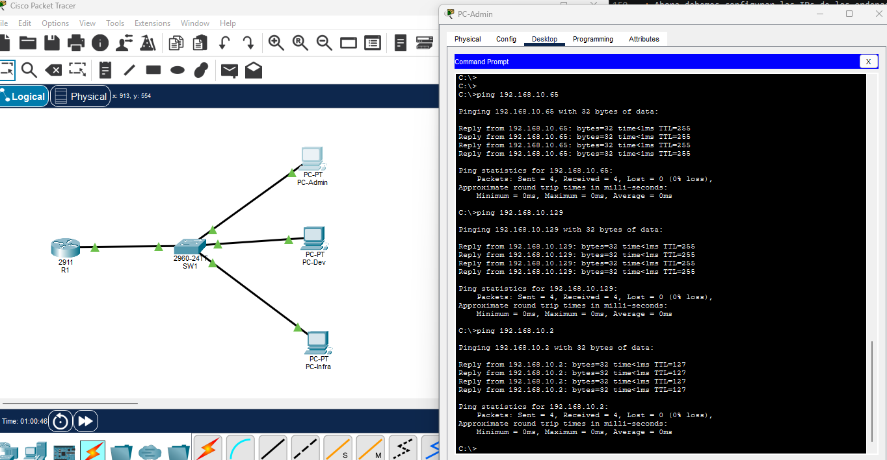
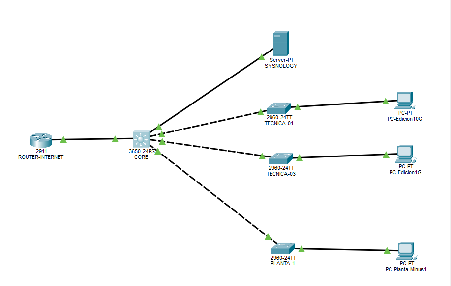
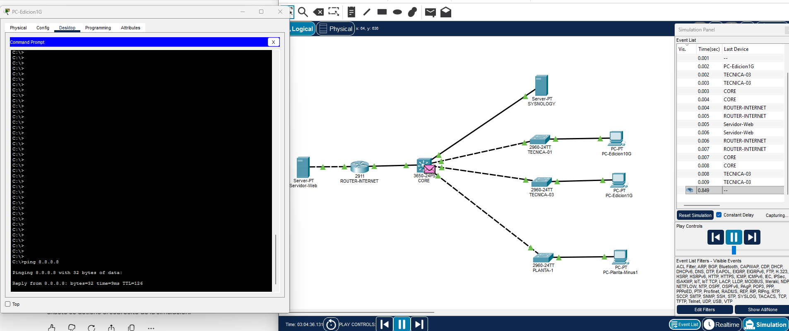
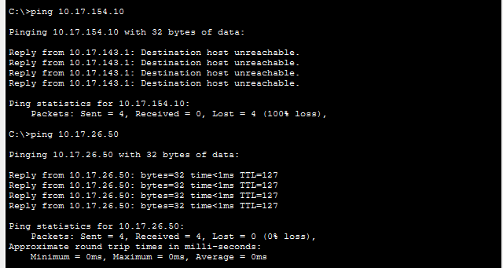

# LAB 7: Dockerfile Multi-Stage y Docker Compose con Base de Datos


## Table of contents

- [Ejercicio](#ejercicio)
- [Subnetting](#subnetting)
- [Routing](#routin)
- [Equipos](#equipos)
- [Verificacion](#verificacion)
- [Troubleshooting](#troubleshooting)
- [Herramientas de diagnostico](#herramientas-de-diagnostico)
- [Ticket](#ticket)
- [Infraestructura ex empresa](#infraestrutura-ex-empresa)
- [Simulaciones](#simulaciones)
- [Author](#author)

## Ejercicio

+ Las ofertas de empleo para SysAdmin y Cloud/DevOps valoran enormemente saber lidiar con redes porque el 80% de los fallos en producción (latencias caídas, microcortes, servicios que no se ven entre sí) son problemas de red, rutas, firewalls o puertos bloqueados.

+ Objetivos del LAB 8
    - Diseño de Subnetting IPv4: Calcular subredes a partir de una red base para separar departamentos o áreas lógicas.
    - Configuración de VLANs (Virtual LANs): Aislar el tráfico en un switch capa 2 mediante el estándar IEEE 802.1Q.
    - Router-on-a-Stick: Configurar subinterfaces troncales en un router físico/virtual para permitir la comunicación (inter-VLAN routing) entre distintas VLANs.
    - Pruebas de conectividad (Ping): Diagnosticar y verificar que los pings funcionen exclusivamente donde deben hacerlo según las políticas de red.

+ En este laboratorio simularemos una topología corporativa real:
    - Subnetting IPv4: Partiremos de una red base y la dividiremos lógicamente para departamentos (ej. Administración, Desarrollo, Infraestructura).
    - VLANs (Virtual Local Area Networks): Configuraremos un Switch de Capa 2 para aislar el tráfico físico en dominios de difusión lógicos independientes (VLAN 10, VLAN 20, VLAN 30).
    - Router-on-a-Stick: Configuraremos un Router conectado al Switch mediante un enlace troncal (trunk) con subinterfaces para permitir que las diferentes VLANs se comuniquen de forma controlada.
    - Verificación: Comprobaremos mediante pings cruzados qué hosts se ven y cuáles están correctamente aislados.

## Subnetting

+ El escenario del LAB 8: Imaginemos que nuestra empresa nos ha asignado la red raíz `192.168.10.0/24` para desplegar nuestra infraestructura local.

+ Tenemos que dar servicio a 3 departamentos o zonas diferentes, cada una con sus propias necesidades de dispositivos (PCs, servidores, impresoras):
    - Departamento de Administración: Necesita al menos 50 direcciones IP utilizables para equipos.
    - Departamento de Desarrollo: Necesita al menos 20 direcciones IP utilizables para equipos.
    - Departamento de Infraestructura (Servidores): Necesita al menos 10 direcciones IP utilizables para servidores y pasarelas.

+ Has calculado los bloques de sufijos de manera perfecta:
    - Administración (50 hosts): Bloque /26 (64 IPs totales, 62 utilizables (red y broadcaste)).
    - Desarrollo (20 hosts): Bloque /27 (32 IPs totales, 30 utilizables).
    - Infraestructura (10 hosts): Bloque /28 (16 IPs totales, 14 utilizables).

  

+ Recuerda la tabla que calculamos basándonos en las necesidades reales:
- **Infraestructura (192.168.10.0/28):** Es una red pequeña (14 IPs útiles). La hemos colocado al principio (.1 a .14) porque los servidores e infraestructura fija suelen organizarse en los primeros bloques lógicos de la empresa.
- **Administración (192.168.10.64/26):** Requiere 50 IPs. Como la anterior red consumió del .0 al .15, dejamos un margen de seguridad y arrancamos este bloque en la IP .64 hasta la .126.
- **Desarrollo (192.168.10.128/27):** Requiere 30 IPs. Arranca limpiamente en la IP .128 hasta la .158.

  

+ Entramos al Switch y configuramos los enlaces al router y a los equipos finales:
```bash
Switch> enable
Switch# configure terminal

! 1. Crear las VLANs
Switch(config)# vlan 10
Switch(config-vlan)# name Infraestructura
Switch(config-vlan)# vlan 20
Switch(config-vlan)# name Administracion
Switch(config-vlan)# vlan 30
Switch(config-vlan)# name Desarrollo
Switch(config-vlan)# exit

! 2. Asignar los puertos de acceso a sus respectivas VLANs
Switch(config)# interface fastEthernet 0/2
Switch(config-if)# switchport mode access
Switch(config-if)# switchport access vlan 20
Switch(config-if)# exit

Switch(config)# interface fastEthernet 0/3
Switch(config-if)# switchport mode access
Switch(config-if)# switchport access vlan 30
Switch(config-if)# exit

Switch(config)# interface fastEthernet 0/4
Switch(config-if)# switchport mode access
Switch(config-if)# switchport access vlan 10
Switch(config-if)# exit

! 3. Configurar el puerto que va al router como TRONCAL (Trunk) para que pasen todas las VLANs
Switch(config)# interface fastEthernet 0/1
Switch(config-if)# switchport mode trunk
Switch(config-if)# end
Switch# write
```
> Si te equivocas de vlan y pones vlan 40 , pones acto seguido vlan 10 y se sobreescribe.  
> Para borrar una vlan sin estar dentro de una interfaz se pone `Switch(config)# no vlan 40`

+ Explicación detallada de cada comando que usamos en el Switch (SW1)
    - **enable:** Qué hace: Te saca del modo usuario básico (>) y te eleva al modo privilegiado (#), equivalente a ser root o Administrator.
    - **configure terminal (o abreviado conf t):** Qué hace: Entra en el modo de configuración global. A partir de aquí, cualquier cambio que escribas afectará a la configuración activa del dispositivo.
    - **vlan 10 / name Infraestructura:** Qué hace: Crea la VLAN número 10 en la base de datos interna del switch y le asigna una etiqueta de texto descriptiva (Infraestructura) para que los técnicos sepan qué tráfico pasa por ahí.
    - **interface fastEthernet 0/2:** Qué hace: Selecciona la interfaz física concreta (puerto 2 del switch) para configurarla individualmente.
    - **switchport mode access:** Qué hace: Define el puerto como puerto de acceso. Esto significa que ese puerto va destinado exclusivamente a un dispositivo final (un PC, una impresora, un servidor), y no a otro switch o router.
    - **switchport access vlan 20:** Qué hace: Etiqueta el tráfico de ese puerto. Cualquier paquete de red que entre por el puerto FastEthernet 0/2 pertenecerá obligatoriamente a la VLAN 20, aislándose del resto.
    - **interface fastEthernet 0/1 + switchport mode trunk**: Qué hace: Configura el puerto 1 como enlace troncal (Trunk). A diferencia de los puertos de acceso, un puerto trunk es una "autopista multicarril" que permite que viajen mezclados los paquetes de todas las VLANs (10, 20 y 30) a través de un único cable físico hacia el Router.

+ Para apagar o reiniciar un puerto de switch (muy útil para troubleshooting):
```bash
Switch(config)# interface fastEthernet 0/4
Switch(config-if)# shutdown      ! Apaga el puerto físicamente
Switch(config-if)# no shutdown   ! Lo vuelve a encender (reinicia el enlace)
```

## Routing

+ **El Router-on-a-Stick:** Ahora que el switch ya sabe separar el tráfico por VLANs y enviarlo por el puerto troncal (FastEthernet 0/1), nos falta configurar el Router (R1) para que actúe como el "pegamento" (Gateway) que permite que la VLAN 10 hable con la VLAN 20.

+ El concepto de Router-on-a-Stick consiste en tomar una única interfaz física del router (GigabitEthernet 0/0) y dividirla lógicamente en subinterfaces (una por cada VLAN), de modo que cada subinterface actúe como la puerta de enlace (gateway) y la ruta predeterminada de su respectiva red.

```bash
Router> enable
Router# configure terminal

! 1. Encender la interfaz física principal (sin dirección IP)
Router(config)# interface gigabitEthernet 0/0
Router(config-if)# no shutdown
Router(config-if)# exit

! 2. Subinterface para la VLAN 10 (Infraestructura)
Router(config)# interface gigabitEthernet 0/0.10
Router(config-subif)# encapsulation dot1Q 10
Router(config-subif)# ip address 192.168.10.1 255.255.255.240
Router(config-subif)# exit

! 3. Subinterface para la VLAN 20 (Administración)
Router(config)# interface gigabitEthernet 0/0.20
Router(config-subif)# encapsulation dot1Q 20
Router(config-subif)# ip address 192.168.10.65 255.255.255.192
Router(config-subif)# exit

! 4. Subinterface para la VLAN 30 (Desarrollo)
Router(config)# interface gigabitEthernet 0/0.30
Router(config-subif)# encapsulation dot1Q 30
Router(config-subif)# ip address 192.168.10.129 255.255.255.224
Router(config-subif)# end
Router# write
```
> interface gigabitEthernet 0/0.10: Crea una subinterface lógica dentro del puerto físico 0/0 usando el punto 10 (por convenio se suele poner el número de la VLAN para aclararse, aunque podría ser cualquiera).

> encapsulation dot1Q 10: Es el comando crítico. Indica al router que esa subinterface debe etiquetar y desetiquetar los paquetes de red utilizando el estándar IEEE 802.1Q con la etiqueta de la VLAN 10. Gracias a esto, el router sabe qué paquete pertenece a qué departamento.

> ip address ...: Asigna la dirección IP que funcionará como Gateway (Puerta de enlace) para todos los equipos de esa VLAN concreta.


## Equipos

+ Ahora debemos configurar las IPs de los ordenadores finales para que apunten a sus respectivas subredes y utilicen la IP del router como su puerta de enlace.

+ Haz clic en cada PC en Packet Tracer, ve a la pestaña Desktop -> IP Configuration y rellena los datos con los rangos que calculamos:
```bash
PC-Admin:
IP Address: 192.168.10.66
Subnet Mask: 255.255.255.192
Default Gateway: 192.168.10.65

PC-Dev:
IP Address: 192.168.10.130
Subnet Mask: 255.255.255.224
Default Gateway: 192.168.10.129

PC-Infra:
IP Address: 192.168.10.2
Subnet Mask: 255.255.255.240
Default Gateway: 192.168.10.1
```
> Verás que los indicadores del enlace entre el Router y el Switch cambian a color verde en Packet Tracer.

## Verificacion

+ Abre la consola de comandos (Command Prompt) dentro de PC-Admin y haz un ping a su puerta de enlace y a las demás subredes:
```bash
ping 192.168.10.65        ! Ping a su propio Gateway (debe responder)
ping 192.168.10.129       ! Ping al Gateway de Desarrollo (inter-VLAN routing, debe responder)
ping 192.168.10.2         ! Ping al PC de Infraestructura (debe responder)
```

  

+ ¿Por qué se ven entre ellos? Imagina que estás sentado en el PC-Admin (192.168.10.66) y haces un ping al PC-Dev (192.168.10.130). A ojos humanos están conectados al mismo Switch, pero a nivel de red están en mundos completamente separados (VLAN 20 vs VLAN 30).
    - La salida del PC: El PC-Admin comprueba su máscara de subred (255.255.255.192) y se da cuenta de que la IP de destino (192.168.10.130) no está en su misma red local. ¿Qué hace? Envía el paquete por defecto a su Puerta de Enlace (Gateway), que es el Router (192.168.10.65).
    - El Switch y la etiqueta (Trunk): El paquete viaja por el cable hasta el Switch (SW1). Como el puerto del PC pertenece a la VLAN 20, el switch le pega una "pegatina" invisible (etiqueta 802.1Q) que dice "Este paquete es de la VLAN 20" y lo empuja por el cable troncal (Trunk) hacia el Router.
    - El Router lo recibe y decide (Inter-VLAN Routing): El Router recibe el paquete en su subinterface GigabitEthernet 0/0.20. Mira la etiqueta, ve que viene de la VLAN 20, y dice: "Vale, acepto el paquete". Luego, el router mira su tabla de rutas interna y piensa: "¿A dónde va esto? Ah, a la red 192.168.10.128/27 (Desarrollo)".
    - El reenvío: El router coge el paquete, le quita la etiqueta de la VLAN 20, le pone la etiqueta de la VLAN 30, y lo reenvía de vuelta por el mismo cable troncal hacia el Switch.
    - La entrega: El switch lee la etiqueta de la VLAN 30, ve que el PC-Dev está en esa VLAN, y le entrega el paquete. El PC-Dev responde, y el ciclo se repite a la inversa.

+ ¿Por qué hemos hecho esta configuración en el mundo real (y en tu futuro profesional)?
    - **Problema de Seguridad (Broadcast Storms y Tráfico Indiscriminado):** Cualquier ordenador de administración podría ver el tráfico de los servidores o infectar con un virus de red toda la oficina en cuestión de segundos porque están en el mismo dominio de difusión. Las VLANs aíslan lógicamente el tráfico por departamentos por pura seguridad y orden.
    - **Optimización de Recursos:** Al seccionar mediante subredes y VLANs, controlas exactamente qué departamentos pueden hablar entre sí (mediante reglas de firewall o listas de control de acceso en el router).
    - **El estándar "Router-on-a-Stick":** Históricamente, por cada VLAN necesitabas comprar un puerto físico diferente en un router caro. Con esta técnica de subinterfaces virtuales, aprovechas un único cable físico y un solo puerto de router para enrutar decenas de VLANs corporativas ahorrando costes de hardware masivos. Esto en una entrevista técnica demuestra que sabes exprimir los recursos de red al máximo.

## Troubleshooting

+ Si apagamos una interfaz virtual del router, veremos que el ping ya no es efectivo.
```bash
Router(config)# interface gigabitEthernet 0/0.30
Router(config-subif)# shutdown
```

```bash
C:\>ping 192.168.10.129

Pinging 192.168.10.129 with 32 bytes of data:

Reply from 192.168.10.65: Destination host unreachable.
Reply from 192.168.10.65: Destination host unreachable.
Reply from 192.168.10.65: Destination host unreachable.
Request timed out.

Ping statistics for 192.168.10.129:
    Packets: Sent = 4, Received = 0, Lost = 4 (100% loss),
```

## Herramientas de diagnostico

El Kit de Herramientas de Diagnóstico (Real-World Troubleshooting)
+ A. traceroute (o tracert en Windows) — El mapa de saltos
    - Qué hace: Rorrea el camino exacto que da un paquete de red desde tu ordenador hasta el destino, mostrando la IP de cada router (salto) por el que pasa.
    - Cómo usarlo: traceroute 192.168.10.130 (o tracert en Windows).
    - Cómo interpretar el resultado:
        - Si ves que los saltos llegan hasta la IP del router (192.168.10.65) y a partir de ahí empieza a dar asteriscos (* * *) o se congela, el problema está en el router o en el destino (por ejemplo, la subinterface 30 estaba apagada, como probaste antes).
        - Si el primer salto ni siquiera responde, el problema está en tu propia pasarela o en tu tarjeta de red local.

+ B. arp -a — Resolución de direcciones físicas (MAC)
    - Qué hace: Muestra la tabla ARP de tu equipo, que es la libreta de direcciones donde tu ordenador asocia la IP de un vecino de red con su dirección física (MAC) del switch.
    - Cómo interpretar el resultado: Si intentas hablar con un equipo de tu misma VLAN y su MAC aparece como incompleta o no aparece (<incomplete>), significa que el switch no está reenviando las tramas correctamente, hay un puerto bloqueado por seguridad (port security/spanning tree) o el cable físico está dañado.

+ C. nslookup o dig — Resolución de Nombres DNS
    - Qué hace: Consulta al servidor de nombres si el dominio (ej. database.empresa.local) traduce correctamente a una dirección IP.
    - Cómo interpretar el resultado:
        - Si te devuelve Server failure o NXDOMAIN, el problema no es de red ni de rutas, ¡es que el servidor DNS está caído o mal configurado! Muy útil cuando la red funciona pero las aplicaciones "no encuentran" los servicios.

+ D. Comandos de Verificación en los Switches y Routers Cisco (CLI Real)
    - Si tuvieras acceso por consola o SSH al switch o router de la empresa, ejecutarías comandos de estado (show commands):
        - `show ip interface brief`: Te muestra de un vistazo todas las interfaces físicas y virtuales (subinterfaces), indicando si están up/up (encendidas y conectadas) o administratively down (apagadas a propósito con shutdown). Si ves un puerto en down, ya sabes dónde está la avería.
        - `show vlan brief`: Muestra qué puertos físicos pertenecen a qué VLAN. Si un usuario de administración se queja de que no tiene red y ves que su puerto está asignado por error a la VLAN de invitados, ya has encontrado el fallo.
        - `show mac-address-table`: Te dice qué dirección MAC está conectada en cada puerto físico del switch. Si un switch port parpadea en naranja o bloquea tráfico por bucles (Spanning Tree Protocol), este comando te chiva qué dispositivo está generando problemas de tráfico.


## Ticket

+ «Hola, soy el desarrollador en la PC-Dev (192.168.10.130) y la aplicación da timeout conectando con el servidor de infraestructura (PC-Infra, 192.168.10.2). Arréglarlo por favor».

**PASO 1: Comprobar la ruta con tracert (o traceroute)**
```bash
C:\>tracert 192.168.10.2

Tracing route to 192.168.10.2 over a maximum of 30 hops: 

  1   0 ms      0 ms      0 ms      192.168.10.129
  2   0 ms      0 ms      0 ms      192.168.10.2

Trace complete.
```
> ¿Qué verás en pantalla?:  
    - Salto 1: 192.168.10.129 (Tu propia puerta de enlace en el router).  
    - Salto 2: 192.168.10.2 (El destino final).  
> Interpretación del analista: Si los saltos responden con tiempos limpios (ej. 2ms), la red está perfecta. El problema de que la aplicación no conecte no es de red, sino de puertos de la aplicación, credenciales o el servicio de base de datos caído en el servidor.  
> ¿Y si se congela en asteriscos (* * *) en el salto 2?: Significa que el paquete llegó al router, pero el router no sabe por dónde reenviarlo o la subinterface de destino está apagada.  

**PASO 2: Verificar la tabla ARP con arp -a**  
Si sospechas que un equipo nuevo no se comunica con su vecino local, ejecutas: `arp -a`  
```bash
C:\>arp -a
  Internet Address      Physical Address      Type
  192.168.10.129        0001.422b.d301        dynamic
```

+ Qué verás: Una lista de direcciones IP asociadas a su dirección física MAC (ej. 192.168.10.1  ->  0001.64ab.cdef).
+ Interpretación del analista: Si ves que la IP del destino aparece como dynamic pero la MAC es extraña o directamente no aparece tras hacer un ping previo, hay un problema de capa 2 (un puerto mal configurado en el switch o un cable dañado).


**PASO 3: Auditoría rápida desde los equipos de red (Cisco CLI)**  
Si entras por consola al Switch (SW1) para auditar la salud del puerto del usuario: `show mac-address-table`  
```bash
SW1>show mac-address-table
          Mac Address Table
-------------------------------------------

Vlan    Mac Address       Type        Ports
----    -----------       --------    -----

   1    0001.422b.d301    DYNAMIC     Fa0/1
  10    0001.422b.d301    DYNAMIC     Fa0/1
  10    0006.2a43.e1bb    DYNAMIC     Fa0/4
  20    0001.422b.d301    DYNAMIC     Fa0/1
  30    0001.422b.d301    DYNAMIC     Fa0/1
  30    000d.bd03.1760    DYNAMIC     Fa0/3
```
> Qué verás: Qué dirección MAC de qué ordenador está enchufada físicamente en cada puerto del switch (Fa0/1, Fa0/2...). Te permite coger el cable físico exacto en el rack de comunicaciones si un puerto está dando errores de CRC (trama corrupta).

## Infraestrutura ex empresa

Para replicar esto en nuestro laboratorio, vamos a estructurar una topología que simule exactamente vuestro entorno:
+ Core Router (R-Core): Actuará como el enrutador central con subinterfaces para las VLANs 26, 154 y 143.
+ Switch Core / Distribución: Conectado al router mediante enlaces troncales con redundancia.
+ Switch de Planta 1Gb (VLAN 26 DHCP): Switches de acceso donde los equipos cogen IP automáticamente por DHCP.
+ Switch de Alta Velocidad (Zyxel 10G / VLAN 154): Para las salas de edición exigentes.
+ Planta -1 (VLAN 143): Simulada con otro switch y restricciones de tráfico.


En el 99% de los entornos de postproducción, centros de datos y oficinas técnicas, el "Core" principal es un Switch de Capa 3 (Layer 3 Switch) o un Switch Core con capacidad de enrutamiento (como los modelos Cisco Catalyst de gama alta, por ejemplo, la serie 4500 o 6500, o switches modulares similares).
+ ¿Por qué se llama Core? Porque es el "núcleo" de la red. Todos los switches de las plantas, los servidores y las cabinas de almacenamiento tiran cables de fibra hacia él.
+ ¿Por qué actúa como Switch y a la vez como Router?
    - A nivel físico y de puertos: Funciona como un switch rapidísimo de alta densidad de puertos (con módulos SFP+ de 10Gb) para conmutar paquetes a toda velocidad entre los switches de las plantas.
    - A nivel lógico (Capa 3): Tiene activado el enrutamiento IP. Es decir, dentro de ese mismo chasis del Core se configuran las interfaces virtuales (SVIs, equivalentes a las subinterfaces que vimos antes en el router) para las VLANs 26, 154 y 143. Por eso podía enrutar el tráfico entre la VLAN 26 y la 154 sin que hiciera falta un router externo separado.

¿Y dónde entraba o salía el Internet? (El Firewall o Router Perimetral)
+ Cuando mencionas que tenías dudas sobre si tenía salida a internet o qué más había detrás:
    - El Switch Core que tenías en la planta 2 era el jefe de la red interna (LAN). Movía todo el tráfico local a velocidad de vértigo entre vuestros equipos de edición, las SAN/NAS y los switches de planta.
    - Sin embargo, para salir a Internet, o para conectar con otras sedes corporativas o la nube, ese Core se conectaba mediante otro enlace de fibra o cobre a un Firewall perimetral (por ejemplo, un equipo tipo Cisco ASA, Fortinet o Palo Alto) o a un router de operador (router de salida a internet). Ese Firewall era el encargado de aplicar las políticas de seguridad estritas y hacer NAT para dar salida a la web.


### Topologia

+ En nuestra topología simularemos:
    - Un Switch Core de Capa 3 en el centro.
    - Los enlaces de fibra simulados mediante conexiones Gigabit/EtherChannel.
    - Las VLANs que mencionaste:
        + VLAN 26 (10.17.26.0/24): Tráfico general / DHCP de planta.
        + VLAN 154 (10.17.154.0/24): Tráfico de alta velocidad para edición.
        + VLAN 143 (10.17.143.0/24): Planta -1.

+ El CORE (Switch L3):
    - Tiene 24 interfaces físicas. Cada switch de planta o servidor se conecta directamente a una interfaz física del Core mediante fibra.
    - El enlace Core <-> Switch de Planta es un TRONCAL (Trunk). ¿Por qué? Porque por ese único cable físico de fibra que va del Core al switch de planta (por ejemplo, TECNICA-03) tienen que viajar varias VLANs a la vez (por ejemplo, por defecto los equipos van en la VLAN 26, pero si un puerto concreto necesita la VLAN 154, el switch de planta etiqueta ese tráfico y lo manda por el tronco hacia el Core).

+ El Servidor SYSNOLOGY:
    - Es un servidor que maneja volúmenes pesados y da servicio tanto a la red de 1G (VLAN 26) como a la de 10G (VLAN 154). Por tanto, su puerto conectado al Core debe pertenecer a una red con visibilidad o estar enrutado para que todos puedan alcanzarlo.

+ Los Switches de Acceso (TECNICA-01, TECNICA-03, PLANTA-1):
    - Aquí está la clave que mencionas: por defecto un switch de planta puede tener sus puertos configurados en una VLAN (ej. VLAN 26), pero un puerto específico (como el puerto 10) puede cambiarse de VLAN (a la VLAN 154) mediante comandos de acceso, exactamente igual que cuando abrías ticket a IT para que te reconfigurasen una boca del switch.

### Switch Core

+ El Core es el que sabe de redes (Layer 3). Necesita tener activado el enrutamiento y las VLANs creadas:
```bash
enable
configure terminal
ip routing

vlan 26
 name Red-Tecnica-1G
vlan 154
 name Edicion-10G
vlan 143
 name Planta-Minus-1
exit
```
> Un Switch Core de Capa 3 (como el Catalyst 3650 que tienes en pantalla) combina lo mejor de dos mundos:  
    - A nivel físico (Capa 2): Conmuta tramas a velocidad de vértigo entre sus puertos físicos mediante chips ASIC dedicados.  
    - A nivel lógico (Capa 3): Al activarle el comando ip routing, el switch adquiere la capacidad de enrutar paquetes IP entre diferentes redes (VLANs), exactamente igual que haría un router tradicional. Por eso en tu ex-empresa el Core centralizaba todo el tráfico de la planta sin necesidad de un router separado para la red local.  

> Sobre vlan 26 y name: Sí, al escribir vlan 26 seguida de name Red-Tecnica-1G, el switch crea instantáneamente esa VLAN en su base de datos interna y le asigna esa etiqueta de texto descriptiva.

+ Los enlaces que van a los switches (TECNICA-01, TECNICA-03, PLANTA-1) tienen que ser Trunks (troncales) para que por ahí pasen todas las VLANs que los switches decidan mandar:
```bash
# ! Puerto 1/0/1 hacia TECNICA-01 (Trunk)
interface gigabitEthernet 1/0/1
 switchport mode trunk
 no shutdown

# ! Puerto 1/0/2 hacia TECNICA-03 (Trunk)
interface gigabitEthernet 1/0/2
 switchport mode trunk
 no shutdown

# ! Puerto 1/0/3 hacia PLANTA-1 (Trunk)
interface gigabitEthernet 1/0/3
 switchport mode trunk
 no shutdown
```

+ El enlace que va al SYSNOLOGY puede configurarse según el tipo de puerto que requiera, pero para que su IP pertenezca a la red de alta velocidad (VLAN 154), configuramos su boca en el Core como un puerto de acceso de esa VLAN, o como trunk si el servidor gestiona VLANs (lo habitual en NAS es ponerlo en la VLAN principal de edición, la 154).

```bash
# ! Puerto 1/0/4 hacia SYSNOLOGY (Servidor en VLAN 154)
interface gigabitEthernet 1/0/4
 switchport mode access
 switchport access vlan 154
 no shutdown
exit
```
> Al configurar la interfaz del servidor como switchport mode access y asignarla a la vlan 154, le estás diciendo al puerto: "Este puerto solo acepta tráfico plano de la VLAN 154".  

> ¿Por qué tendrá acceso a ambas redes (154 y 26)? Porque aunque el servidor esté físicamente enchufado en la VLAN 154, el tráfico entre redes diferentes se enruta a través del Core. Cuando un ordenador de la VLAN 26 quiere abrir un archivo del NAS, su paquete viaja al Core, el Core lo enruta a la VLAN 154 y se lo entrega al NAS. ¡El enrutador central permite que se comuniquen de forma controlada!

+ Las Interfaces Virtuales (SVI) en el Core: Como los ordenadores de la VLAN 26, los de la VLAN 154 y los servidores tienen que hablar entre sí, el Core necesita tener sus "puertas lógicas" (IPs de Gateway) encendidas:
```bash
interface vlan 26
 ip address 10.17.26.1 255.255.255.0
 no shutdown

interface vlan 154
 ip address 10.17.154.1 255.255.255.0
 no shutdown

interface vlan 143
 ip address 10.17.143.1 255.255.255.0
 no shutdown
end
write
```
> Siempre que tengas varias VLANs y necesites que los equipos de una red hablen con los de otra (o salgan hacia internet), necesitas obligatoriamente crear una SVI (Switch Virtual Interface) por cada VLAN en el dispositivo de Capa 3 (el Core). Si creas VLANs pero no creas sus SVI ni les pones IP, las VLANs estarán totalmente aisladas y no podrán comunicarse entre sí.

> ¿Qué hace el comando? interface vlan 26 crea la puerta lógica y el comando ip address 10.17.26.1 255.255.255.0 le asigna la IP que actuará como Gateway (Puerta de enlace) para todos los equipos de esa subred.

> end: Te saca instantáneamente de cualquier submenú de configuración y te devuelve al modo privilegiado (CORE#). Es útil para no tener que escribir exit 5 veces seguidas.

> write (o copy running-config startup-config): Guarda la configuración actual en la memoria no volátil (NVRAM) del switch. Si apagas el dispositivo en Packet Tracer o se va la luz en la vida real, si no haces write, perderás toda la configuración.

+ Para ver todas las interfaces y SVI usamos el comando `show ip interface brief`:
```bash
CORE#show ip interface brief
Interface              IP-Address      OK? Method Status                Protocol 
GigabitEthernet1/0/1   unassigned      YES unset  up                    up 
GigabitEthernet1/0/2   unassigned      YES unset  up                    up 
GigabitEthernet1/0/3   unassigned      YES unset  up                    up 
GigabitEthernet1/0/4   unassigned      YES unset  up                    up 
GigabitEthernet1/0/5   unassigned      YES unset  down                  down 
.
.
.
Vlan1                  unassigned      YES unset  administratively down down 
Vlan26                 10.17.26.1      YES manual up                    up 
Vlan143                10.17.143.1     YES manual up                    up 
Vlan154                10.17.154.1     YES manual up                    up
```

### Switches planta

+ Por defecto, en un switch Cisco de acceso (como los 2960), todos los puertos vienen configurados de fábrica en la VLAN 1».
    - Si tú conectas ordenadores sin tocar nada, caerán en la VLAN 1 por defecto.
    - Lo que hacíais en la empresa era dejar los puertos estándar en una VLAN general (ej. VLAN 26), y cuando un puerto específico (como el puerto 10 que mencionabas) requería alta velocidad, abríais un ticket a IT para que entraran a ese puerto concreto (interface fastEthernet 0/10) y lo cambiaran manualmente a la switchport access vlan 154.

+ Configurar TECNICA-01 (VLAN 154 - Edición 10G):
```bash
enable
configure terminal

! 1. Crear la VLAN 154
vlan 154
 name Edicion-10G
exit

! 2. Configurar el puerto que va conectado al CORE (ej. GigabitEthernet 0/1 o FastEthernet 0/1) como Troncal
interface fastEthernet 0/1
 switchport mode trunk
 no shutdown

! 3. Configurar el puerto donde está el PC-Edicion10G (ej. FastEthernet 0/2) en la VLAN 154
interface fastEthernet 0/2
 switchport mode access
 switchport access vlan 154
 no shutdown

exit
write
```

+ Configurar TECNICA-03 (VLAN 26 - Red Técnica 1G y pruebas de cambio de VLAN)
```bash
enable
configure terminal

! 1. Crear la VLAN 26 (y de paso dejamos creada la 154 por si movemos algún puerto como comentaste)
vlan 26
 name Red-Tecnica-1G
vlan 154
 name Edicion-10G
exit

! 2. Configurar el puerto que va conectado al CORE como Troncal
interface fastEthernet 0/1
 switchport mode trunk
 no shutdown

! 3. Configurar el puerto del PC-Edicion1G (ej. FastEthernet 0/2) en la VLAN 26
interface fastEthernet 0/2
 switchport mode access
 switchport access vlan 26
 no shutdown

exit
write
```
> Si el switch TECNICA-01 necesita soportar equipos en la VLAN 26 (además de la 154), debes crear la VLAN explícitamente en su base de datos y configurar el puerto específico (por ejemplo, el puerto 10) con switchport mode access y switchport access vlan 26.

+ Configurar PLANTA-1 (VLAN 143 - Planta -1):
```bash
enable
configure terminal

! 1. Crear la VLAN 143
vlan 143
 name Planta-Minus-1
exit

! 2. Configurar el puerto que va conectado al CORE como Troncal
interface fastEthernet 0/1
 switchport mode trunk
 no shutdown

! 3. Configurar el puerto del PC-Planta-Minus1 (ej. FastEthernet 0/2) en la VLAN 143
interface fastEthernet 0/2
 switchport mode access
 switchport access vlan 143
 no shutdown

exit
write
```

+ Aplicar el rango de acceso solo a los puertos de usuario (del 2 al 24): Ahora configuramos las bocas de usuario (dejando fuera la 0/1) para que pertenezcan a la VLAN que corresponda (en este caso la VLAN 154 para TECNICA-01):
```bash
# tecnica 1
interface range fastEthernet 0/2 - 24
 switchport mode access
 switchport access vlan 154
 no shutdown
end
write

# tecnica 3
interface range fastEthernet 0/2 - 24
 switchport mode access
 switchport access vlan 26
 no shutdown
end
write

# planta -1
interface range fastEthernet 0/2 - 24
 switchport mode access
 switchport access vlan 143
 no shutdown
end
write
```
> no incluimos la 0/1 porque es donde pusimos el enlace al core. si hubieramos configurado Gi0/1, entonces sí cogeriamos todo el rango a toda la misma vlan.

+ ¿Cómo se configura un puerto específico de un Switch de Planta (Ej: el puerto 10)?  
Lo que tú hacías en la realidad ("si conecto un equipo en el puerto 10 y quiero que pase de VLAN 26 a VLAN 154, abro ticket y IT lo cambia") se traduce técnicamente en cambiar el modo de acceso de ese puerto físico en el switch de planta (TECNICA-03):
```bash
#• ! Entras al switch TECNICA-03
enable
configure terminal

# ! Seleccionas el puerto concreto (ej. el puerto FastEthernet 0/10)
interface fastEthernet 0/10
 switchport mode access
 switchport access vlan 154   ! <--- Aquí es donde IT cambiaba la VLAN del puerto por ticket
 no shutdown
end
```
> Al hacer eso, cualquier ordenador que enchufes físicamente en el puerto 10 de ese switch se mudará automáticamente a la red de 10G (10.17.154.0/24), pudiendo ver perfectamente al servidor SYSNOLOGY y al resto de equipos de edición.

### Equipos

+ **Asignar IPs a los PCs Finales y Servidor:** Ahora ve a la configuración de escritorio (Desktop -> IP Configuration) de cada equipo y dales los siguientes valores para que utilicen el Core como su pasarela:
```bash
SYSNOLOGY (Servidor conectado al Core - Puerto 4):
IP Address: 10.17.154.10
Subnet Mask: 255.255.255.0
Default Gateway: 10.17.154.1

PC-Edicion10G (conectado a TECNICA-01):
IP Address: 10.17.154.50
Subnet Mask: 255.255.255.0
Default Gateway: 10.17.154.1

PC-Edicion1G (conectado a TECNICA-03):
IP Address: 10.17.26.50
Subnet Mask: 255.255.255.0
Default Gateway: 10.17.26.1

PC-Planta-Minus1 (conectado a PLANTA-1):
IP Address: 10.17.143.50
Subnet Mask: 255.255.255.0
Default Gateway: 10.17.143.1
```

### Verificaciones

+ Ping PC1 al server y pcs:
```bash
10.17.26.50
C:\>ping 10.17.154.10 / 10.17.154.50 / 10.17.143.50

Pinging 10.17.154.10 with 32 bytes of data:

Reply from 10.17.154.10: bytes=32 time<1ms TTL=127
Reply from 10.17.154.10: bytes=32 time<1ms TTL=127
Reply from 10.17.154.10: bytes=32 time<1ms TTL=127
Reply from 10.17.154.10: bytes=32 time<1ms TTL=127

Ping statistics for 10.17.154.10:
    Packets: Sent = 4, Received = 4, Lost = 0 (0% loss),
Approximate round trip times in milli-seconds:
    Minimum = 0ms, Maximum = 0ms, Average = 0ms
```
> los pings funcionan perfectamente entre los ordenadores y el servidor porque en el Core están configuradas las SVI (las interfaces virtuales con las IPs de Gateway) y los puertos están en modo troncal. Al estar el enrutamiento activado (ip routing), el Core actúa como el "puente inteligente" que coge los paquetes de una VLAN, los lee, busca la ruta hacia la otra VLAN y los entrega en su destino.

+ Comprobar el estado de las interfaces y la tabla de rutas con `show ip route`:
```bash
CORE#show ip route
Codes: C - connected, S - static, I - IGRP, R - RIP, M - mobile, B - BGP
       D - EIGRP, EX - EIGRP external, O - OSPF, IA - OSPF inter area
       N1 - OSPF NSSA external type 1, N2 - OSPF NSSA external type 2
       E1 - OSPF external type 1, E2 - OSPF external type 2, E - EGP
       i - IS-IS, L1 - IS-IS level-1, L2 - IS-IS level-2, ia - IS-IS inter area
       * - candidate default, U - per-user static route, o - ODR
       P - periodic downloaded static route

Gateway of last resort is not set

     10.0.0.0/8 is variably subnetted, 6 subnets, 2 masks
C       10.17.26.0/24 is directly connected, Vlan26
L       10.17.26.1/32 is directly connected, Vlan26
C       10.17.143.0/24 is directly connected, Vlan143
L       10.17.143.1/32 is directly connected, Vlan143
C       10.17.154.0/24 is directly connected, Vlan154
L       10.17.154.1/32 is directly connected, Vlan154
```
> Gateway of last resort is not set: Significa que el Core no tiene configurada una ruta por defecto hacia Internet (lo que veremos justo a continuación para simular la salida al exterior).  

> Las líneas con C (Connected): Indican las redes que el Core conoce de forma directa porque tiene creadas sus interfaces virtuales (SVI):  
    - 10.17.26.0/24 en la Vlan26.  
    - 10.17.143.0/24 en la Vlan143.  
    - 10.17.154.0/24 en la Vlan154.  

> Las líneas con L (Local): Indican la dirección IP exacta asignada a la propia interfaz del Core dentro de esa red (por ejemplo, 10.17.26.1/32), que actúa como la puerta de enlace para los equipos.

+ Comprobar el estado físico y troncal de los enlaces `show interfaces trunk`
```bash
CORE#show interfaces trunk
Port        Mode         Encapsulation  Status        Native vlan
Gig1/0/1    on           802.1q         trunking      1
Gig1/0/2    on           802.1q         trunking      1
Gig1/0/3    on           802.1q         trunking      1

Port        Vlans allowed on trunk
Gig1/0/1    1-1005
Gig1/0/2    1-1005
Gig1/0/3    1-1005

Port        Vlans allowed and active in management domain
Gig1/0/1    1,26,143,154
Gig1/0/2    1,26,143,154
Gig1/0/3    1,26,143,154

Port        Vlans in spanning tree forwarding state and not pruned
Gig1/0/1    1,26,143,154
Gig1/0/2    1,26,143,154
Gig1/0/3    1,26,143,154
```
> Gig1/0/1, Gig1/0/2, Gig1/0/3: Son los tres cables físicos de alta velocidad que conectan el Core con tus switches de planta.  

> Status: trunking: Confirma que los puertos están negociando correctamente y operando como enlaces troncales.  

> Vlans allowed and active: 1, 26, 143, 154: Muestra que por esos tres cables de fibra viaja todo el tráfico etiquetado de todas las VLANs de la empresa simultáneamente.

## Simulaciones

### Salida a Internet

+ **Simular la Salida a Internet con un Router Perimetral:** Para simular cómo salía vuestra red local hacia Internet o hacia otra sede corporativa, necesitamos añadir un Router que haga las veces de Firewall o pasarela perimetral.
    - Añadir un Router y conectarlo al Core
        + Coloca un Router (por ejemplo, el modelo 2911) en tu espacio de trabajo de Packet Tracer. Llámalos ROUTER-INTERNET o FIREWALL.
        + Conecta un cable de red desde un puerto libre del Core (ej. GigabitEthernet 1/0/24) hasta la interfaz del Router (GigabitEthernet 0/0).
    - Configurar la interfaz del Router hacia el Core
        + Entra en la CLI del router y asígnale una IP que pertenezca a una nueva subred de enlace (por ejemplo, 192.168.100.2/24):
        ```bash
        enable
        configure terminal
        interface gigabitEthernet 0/0
        ip address 192.168.100.2 255.255.255.0
        no shutdown
        ```
    - Configurar el puerto del Core hacia el Router
        + En el Core, configuramos esa interfaz como un puerto de capa 3 dedicado (puerto ruteado o en una VLAN de tránsito, pero para hacerlo sencillo usaremos una IP directa):
        ```bash
        configure terminal
        interface gigabitEthernet 1/0/24
        no switchport
        ip address 192.168.100.1 255.255.255.0
        no shutdown
        ```
    - Añadir una Ruta Estática por Defecto en el Core
        + Para que el Core sepa que cualquier tráfico que no sea para la red local debe enviarlo hacia el router de internet, añadimos una ruta por defecto:
        ```bash
        ip route 0.0.0.0 0.0.0.0 192.168.100.2
        end
        write
        ```
> Verificación: Ejecuta show ip route en el Core y comprueba que aparece una línea nueva con una S* (Static default route) apuntando a 0.0.0.0/0.
```bash
CORE#show ip route
Codes: C - connected, S - static, I - IGRP, R - RIP, M - mobile, B - BGP
D - EIGRP, EX - EIGRP external, O - OSPF, IA - OSPF inter area
N1 - OSPF NSSA external type 1, N2 - OSPF NSSA external type 2
E1 - OSPF external type 1, E2 - OSPF external type 2, E - EGP
i - IS-IS, L1 - IS-IS level-1, L2 - IS-IS level-2, ia - IS-IS inter area
candidate default, U - per-user static route, o - ODR
P - periodic downloaded static route

Gateway of last resort is 192.168.100.2 to network 0.0.0.0

10.0.0.0/8 is variably subnetted, 6 subnets, 2 masks
C 10.17.26.0/24 is directly connected, Vlan26
L 10.17.26.1/32 is directly connected, Vlan26
C 10.17.143.0/24 is directly connected, Vlan143
L 10.17.143.1/32 is directly connected, Vlan143
C 10.17.154.0/24 is directly connected, Vlan154
L 10.17.154.1/32 is directly connected, Vlan154

192.168.100.0/24 is variably subnetted, 2 subnets, 2 masks
C 192.168.100.0/24 is directly connected, GigabitEthernet1/0/24
L 192.168.100.1/32 is directly connected, GigabitEthernet1/0/24
S* 0.0.0.0/0 [1/0] via 192.168.100.2
```
> C 192.168.100.0/24 directly connected, GigabitEthernet1/0/24:  
    - Has convertido el puerto Gig1/0/24 del Core en un puerto ruteado puro (con el comando no switchport). Es decir, ese puerto ya no es un puerto de switch normal, sino una boca de router que une tu empresa con el ROUTER-INTERNET.

> S* 0.0.0.0/0 [1/0] via 192.168.100.2:  
    - Esta es la línea clave. Se llama Ruta por Defecto (o Default Route).  
    - Le dice al Core: "Si cualquier PC de cualquier VLAN (26, 154 o 143) intenta enviar un paquete a una IP que NO pertenece a nuestra red local (por ejemplo, 8.8.8.8 de Google), no lo descartes: mándaselo inmediatamente al puerto 192.168.100.2 (el Router de Internet)".  
    - Por eso arriba te sale: Gateway of last resort is 192.168.100.2 (Puerta de enlace de último recurso).  

  


+ **Simulando la llegada a Internet**: Para ver en vivo cómo viaja un paquete desde tu ordenador de edición hasta Internet, vamos a poner un servidor externo (por ejemplo, el servidor de Google) y probar la navegación.
    - En Packet Tracer, añade un equipo tipo Server al lado del ROUTER-INTERNET. Renómbralo como Google-DNS o Servidor-Web.
    - Conéctalo con un cable directo desde la interfaz GigabitEthernet 0/1 del Router hacia el servidor.
    - Configura la IP del servidor en su pestaña Desktop -> IP Configuration:
        - IP Address: 8.8.8.8
        - Subnet Mask: 255.255.255.0
        - Default Gateway: 8.8.8.1
    
    - Configurar la interfaz de salida en el Router:
    ```bash
    configure terminal
    interface gigabitEthernet 0/1
    ip address 8.8.8.1 255.255.255.0
    no shutdown
    exit
    ```
    
    - Añadir la ruta de vuelta en el Router: Para que el Router sepa devolver la respuesta a tu red local 10.17.0.0:
    ```bash
    ip route 10.17.0.0 255.255.0.0 192.168.100.1
    end
    write
    ```
> En lugar de hacer un ping a ciegas en la consola, vamos a ver el paquete viajar físicamente paso a paso: `ping 8.8.8.8`  

  

> La Ruta del Core (ip route 0.0.0.0 0.0.0.0 192.168.100.2):  
    - Significa: "Señor Core, si alguien le pide un paquete para una dirección que usted no conoce en la empresa (como Google o una página web), no se rompa la cabeza: écheselo al hombro y mándeselo al Router que está en la IP 192.168.100.2". A esto se le llama Ruta por Defecto (o puerta de salida al exterior).

> La Ruta del Router (ip route 10.17.0.0 255.255.0.0 192.168.100.1):  
    - Significa: "Señor Router, si desde Internet te devuelven una respuesta dirigida a cualquier ordenador de nuestra empresa (cuya IP empiece por 10.17...), devuélvesela al Core que está en la IP 192.168.100.1".  
    - Sin esta ruta de vuelta, el paquete llega a Internet, pero al intentar regresar, el router se pierde y lo descarta (esto se llama enrutamiento asimétrico o falta de ruta de retorno).


### Aislamiento de VLANs

+ El aislamiento de tráfico mediante Listas de Control de Acceso (ACL).

+ Este escenario simula una situación real de seguridad: por motivos normativos o de privacidad, los equipos de la VLAN 143 (Planta -1) no deben tener permitido hacer ping (ICMP) ni comunicarse libremente con la red de edición general, pero sí deben poder acceder a servicios específicos como el almacenamiento del servidor NAS (SYSNOLOGY).

1. **Crear una ACL estándar o extendida en el Core**:  
Para filtrar el tráfico entre redes de forma precisa, creamos una ACL extendida en el Core que bloquee el tráfico ICMP (pings) desde la VLAN 143 hacia la VLAN 154, permitiendo el resto:
```bash
configure terminal
access-list 100 deny icmp 10.17.143.0 0.0.0.255 10.17.154.0 0.0.0.255
access-list 100 permit ip any any
```
> Verificación: Ejecuta show access-lists en el Core para comprobar que la regla se ha registrado correctamente.


2. **Aplicar la ACL a la interfaz virtual de origen**:  
Asociamos la regla de filtrado a la SVI de la red de origen (Vlan143) en dirección de entrada (inbound):  
```bash
interface vlan 143
 ip access-group 100 in
end
write
```
> Verificación: Ejecuta show ip interface vlan 143 para confirmar que la ACL de entrada está aplicada y activa.

3. **Validar el bloqueo de ping y el acceso a servicios**  
    - Desde el PC-Planta-Minus1 (10.17.143.50), intenta hacer un ping al servidor SYSNOLOGY (10.17.154.10). Debe fallar (Request timed out).

    - Comprueba que el resto de comunicaciones permitidas siguen operativas.

  
> Sin embargo, como no hemos bloqueado los puertos de red de los servicios, el tráfico de otras aplicaciones (como el acceso a carpetas compartidas SMB del NAS o escritorios remotos VNC) sigue estando totalmente permitido.


### Bloquear el mapeo de unidades

+ Necesitamos utilizar Listas de Control de Acceso (ACL) Extendidas que apunten directamente a los puertos TCP/UDP específicos que utilizan esos servicios.

+ Cada servicio de red utiliza unos puertos estándar determinados. Por tanto, para bloquearlos mediante ACL en el Core, la lógica técnica sería la siguiente:

1. **Bloquear el acceso por Escritorio Remoto (VNC)**  
El protocolo VNC utiliza por defecto los puertos TCP 5900 en adelante (según la sesión). Si quieres prohibir que la VLAN 143 se conecte por VNC al resto de redes, la regla denegaría el tráfico hacia esos puertos:
```bash
access-list 101 deny tcp 10.17.143.0 0.0.0.255 any eq 5900
access-list 101 permit ip any any
``` 

2. **Bloquear el mapeo de unidades de red (SMB / NAS)**  
El protocolo SMB (compartición de archivos de Windows y NAS como el SYSNOLOGY) utiliza los puertos TCP 445 y 139. Si quieres evitar que la VLAN 143 pueda montar o leer los volúmenes del servidor NAS, bloquearías esos puertos:
```bash
access-list 102 deny tcp 10.17.143.0 0.0.0.255 host 10.17.154.10 eq 445
access-list 102 deny tcp 10.17.143.0 0.0.0.255 host 10.17.154.10 eq 139
access-list 102 permit ip any any
```

3. **Aplicamos las ACL en la interfaz virtual de entrada**  
Igual que hicimos antes: se agrupan en una ACL extendida y se aplican en la interfaz virtual de entrada (interface vlan 143 con ip access-group ... in). De esta forma, el Core analiza el paquete, detecta que va dirigido al puerto de SMB o VNC y lo descarta de manera silenciosa antes de que llegue a su destino:
```bash
interface vlan 143
 ip access-group 101 in
end
write

interface vlan 143
 ip access-group 102 in
end
write
```

## Author
+ Miguel — [GitHub](https://github.com/mamoros-dev) · [LinkedIn](https://www.linkedin.com/in/miguel-amoros-moret/)
