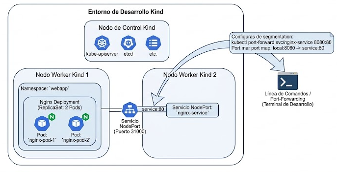

# LAB 9: Un Deployment y un Service en Kubernetes en local (Minikube / Kind)

  

## Table of contents

- [Ejercicio](#ejercicio)
- [Crear cluster kind](#crear-cluster-kind)
- [Crear manifiestos de la aplicacion](#crear-manifiestos-de-la-aplicacion)
- [Verificaciones](#verificaciones)
- [MINIKUBE](#minikube)
- [Kind vs Minikube](#kind-vs-minikube)
- [Author](#author)

## Ejercicio

+ En este laboratorio vamos a pasar de la infraestructura clásica de redes y máquinas virtuales a un entorno de orquestación de contenedores con Kubernetes, simulando cómo empaquetar, desplegar y exponer aplicaciones de alta disponibilidad de forma declarativa (con manifiestos en YAML).

+ En Kubernetes no le dices "crea este contenedor y conéctalo aquí" como harías en Docker puro. Kubernetes trabaja con el concepto de Infraestructura Declarativa: tú defines el estado deseado en un archivo YAML, se lo das al clúster, y el motor interno de Kubernetes se pelea para que la realidad coincida con tus deseos.

+ Preparación del entorno local  
    - Minikube: Levanta una máquina virtual local (con Docker o VirtualBox) que incluye un cluster de Kubernetes completo y un panel gráfico opcional (minikube dashboard). Ideal para entornos de aprendizaje y pruebas robustas.

    - Kind (Kubernetes in Docker): Levanta nodos de Kubernetes ejecutándose como contenedores dentro de tu propio Docker local. Es extremadamente ligero, rápido y muy utilizado en pipelines de CI/CD.

+ Para este laboratorio usaremos dos piezas fundamentales:
    - **El Deployment (El Cerebro y los Músculos):**
        + Para qué sirve: Gestiona el ciclo de vida de tus Pods (las unidades mínimas que ejecutan contenedores). Si un contenedor se cuelga o tu portátil se queda sin memoria, el Deployment destruye el Pod dañado y levanta uno nuevo automáticamente. Además, gestiona las réplicas (escalado horizontal).

    - **El Service (El Repartidor de Tráfico / Balanceador):**
        + Para qué sirve: Los Pods son efímeros; cambian de IP constantemente cuando se reinician. El Service actúa como una IP virtual estática y un balanceador de carga que redirige el tráfico de red de forma inteligente hacia los Pods que estén sanos y disponibles en ese momento.

## Crear cluster kind

+ Vamos a crear un archivo de configuración para Kind que simule una arquitectura profesional con un nodo Master (Control Plane) y dos nodos Worker, tal y como tendrías en un entorno real de producción en la nube (AWS EKS, Google GKE o Azure AKS).

+ Crea un archivo llamado kind-cluster.yaml en tu directorio de trabajo con la siguiente estructura multi-nodo:
```YAML
kind: Cluster
apiVersion: kind.x-k8s.io/v1alpha4
name: devops-cluster
nodes:
  - role: control-plane
  - role: worker
  - role: worker
```
> ¿Por qué multi-nodo? Porque en producción nunca corres todo en una sola máquina. Tener un plano de control separado de los nodos de trabajo (workers) te permite entender cómo programa Kubernetes las cargas de trabajo (scheduling).

+ Desplegar el clúster con Kind:
```bash
kind create cluster --config kind-cluster.yaml
```
> Qué ocurre por debajo: Kind descarga una imagen optimizada de Kubernetes, levanta tres contenedores Docker interconectados simulando los nodos y configura automáticamente el contexto local de kubectl para que hable con ellos.

+ Validar el clúster recién creado:
```bash
kubectl get nodes
NAME                           STATUS   ROLES           AGE   VERSION
devops-cluster-control-plane   Ready    control-plane   44s   v1.30.0
devops-cluster-worker          Ready    <none>          22s   v1.30.0
devops-cluster-worker2         Ready    <none>          23s   v1.30.0
```
> Verificación esperada: Verás tres nodos (devops-cluster-control-plane, devops-cluster-worker, devops-cluster-worker2) en estado Ready.


## Crear manifiestos de la aplicacion

+ Crear el archivo de despliegue (app-deployment.yaml): 

```YAML
apiVersion: apps/v1
kind: Deployment
metadata:
  name: web-app-deployment
  labels:
    app: web-app
spec:
  replicas: 2
  selector:
    matchLabels:
      app: web-app
  template:
    metadata:
      labels:
        app: web-app
    spec:
      containers:
      - name: nginx
        image: nginx:alpine
        ports:
        - containerPort: 80
---
apiVersion: v1
kind: Service
metadata:
  name: web-app-service
spec:
  type: NodePort
  selector:
    app: web-app
  ports:
    - port: 80          # Puerto interno del servicio al que apuntan los pods
      targetPort: 80    # Puerto donde escucha el contenedor Nginx
      nodePort: 30080   # Puerto abierto en los nodos físicos/Docker para acceso externo
```

+ Aplicar los manifiestos al Clúster:
```bash
kubectl apply -f app-deployment.yaml
```
> Para qué sirve: kubectl apply es el comando clave del enfoque declarativo. Compara el archivo YAML con el estado actual del clúster y aplica únicamente los cambios necesarios (crear, actualizar o eliminar recursos).

+ Verificamos que todo ha arrancado correctamente:
```bash
miguel@DESKTOP-G47I0DM:~/projects/terraform/lab-09 (feature/lab-09-kind *)$ kubectl apply -f kind/app-deployment.yaml 
deployment.apps/web-app-deployment created
service/web-app-service created
miguel@DESKTOP-G47I0DM:~/projects/terraform/lab-09 (feature/lab-09-kind *)$ kubectl get deployments
NAME                 READY   UP-TO-DATE   AVAILABLE   AGE
web-app-deployment   2/2     2            2           11s
miguel@DESKTOP-G47I0DM:~/projects/terraform/lab-09 (feature/lab-09-kind *)$ kubectl get pods -o wide
NAME                                  READY   STATUS    RESTARTS   AGE   IP           NODE                     NOMINATED NODE   READINESS GATES
web-app-deployment-867698b98d-h7xn5   1/1     Running   0          16s   10.244.1.2   devops-cluster-worker2   <none>           <none>
web-app-deployment-867698b98d-l89lf   1/1     Running   0          16s   10.244.2.2   devops-cluster-worker    <none>           <none>
miguel@DESKTOP-G47I0DM:~/projects/terraform/lab-09 (feature/lab-09-kind *)$ kubectl get services
NAME              TYPE        CLUSTER-IP     EXTERNAL-IP   PORT(S)        AGE
kubernetes        ClusterIP   10.96.0.1      <none>        443/TCP        4m47s
web-app-service   NodePort    10.96.195.81   <none>        80:30080/TCP   20s
```
> ¿Qué debes buscar? Verás que los Pods se han distribuido automáticamente entre tus dos nodos worker, garantizando alta disponibilidad.

## Verificaciones

+ Puedes probar el acceso localmente haciendo una petición de prueba o mapeando el puerto del nodo con kubectl port-forward.
```bash
ubectl port-forward service/web-app-service 8080:80
Forwarding from 127.0.0.1:8080 -> 80
Forwarding from [::1]:8080 -> 80
Handling connection for 8080
Handling connection for 8080

curl  localhost:8080
<!DOCTYPE html>
<html>
<head>
<title>Welcome to nginx!</title>
<style>
```
> ¿Para qué sirve? Este comando abre un túnel directo desde el puerto 8080 de tu propio ordenador hacia el puerto 80 del servicio de Kubernetes.  
> Cómo probarlo: Abre tu navegador web o ejecuta en la terminal curl http://localhost:8080, ¡y verás la página de bienvenida de Nginx ("Welcome to nginx!") respondiendo directamente desde el clúster de Kubernetes!  

+ Prueba de resiliencia (Autoscurado): Si ejecutas kubectl delete pod <nombre-de-un-pod>, verás que de manera instantánea el Deployment detecta que falta una réplica y levanta un pod nuevo para cumplir con el requisito de tener siempre 2 réplicas activas.
```bash
miguel@DESKTOP-G47I0DM:~/projects/terraform/lab-09 (feature/lab-09-kind *)$ kubectl delete pod web-app-deployment-867698b98d-h7xn5
pod "web-app-deployment-867698b98d-h7xn5" deleted from default namespace
miguel@DESKTOP-G47I0DM:~/projects/terraform/lab-09 (feature/lab-09-kind *)$ *)$ kubeget pods -w
NAME                                  READY   STATUS    RESTARTS   AGE
web-app-deployment-867698b98d-htpsz   1/1     Running   0          7s
web-app-deployment-867698b98d-l89lf   1/1     Running   0          2m23s
web-app-deployment-867698b98d-l89lf   1/1     Terminating   0          3m
web-app-deployment-867698b98d-wns66   0/1     Pending       0          0s
web-app-deployment-867698b98d-wns66   0/1     Pending       0          0s
web-app-deployment-867698b98d-wns66   0/1     ContainerCreating   0          0s
web-app-deployment-867698b98d-l89lf   0/1     Terminating         0          3m
web-app-deployment-867698b98d-l89lf   0/1     Terminating         0          3m
web-app-deployment-867698b98d-l89lf   0/1     Terminating         0          3m1s
web-app-deployment-867698b98d-l89lf   0/1     Terminating         0          3m1s
web-app-deployment-867698b98d-wns66   1/1     Running             0          1s

miguel@DESKTOP-G47I0DM:~/projects/terraform/lab-09 (feature/lab-09-kind *)$ kubectl get pods 
NAME                                  READY   STATUS    RESTARTS   AGE
web-app-deployment-867698b98d-htpsz   1/1     Running   0          60s
web-app-deployment-867698b98d-wns66   1/1     Running   0          16s
```

+ Eliminar cluster de King:
```bash
kind delete cluster --name devops-cluster
```
> Verificación: Al ejecutar kubectl get nodes, te indicará que no hay un clúster activo o que el contexto no es válido.


## MINIKUBE

+ Instalación Linux:
```bash
curl -LO https://storage.googleapis.com/minikube/releases/latest/minikube-linux-amd64
sudo install minikube-linux-amd64 /usr/local/bin/minikube && rm minikube-linux-amd64

minikube version
minikube version: v1.39.0
commit: 7a9f6a841470a207de8cf4bafcccee0969d8ba10
```

+ Inicia Minikube utilizando el driver de Docker (para mantener la similitud con contenedores):
```bash
minikube start --driver=docker
```
> Qué ocurre por debajo: Minikube descarga e inicia una única máquina virtual ligera (contenedor Docker especial) que actúa como un clúster de Kubernetes completo de nodo único (Master + Worker combinados).

+ Verificar Minikube y reutilizar el manifiesto:
```bash
# Comprueba que todo está correcto ejecutando:
minikube status
minikube
type: Control Plane
host: Running
kubelet: Running
apiserver: Running
kubeconfig: Configured

kubectl get nodes
NAME       STATUS   ROLES           AGE   VERSION
minikube   Ready    control-plane   62s   v1.37.0

# Vuelve a aplicar nuestro archivo de despliegue anterior para ver que funciona exactamente igual en Minikube
kubectl apply -f app-deployment.yaml
deployment.apps/web-app-deployment created
service/web-app-service created

kubectl get deployments.apps 
NAME                 READY   UP-TO-DATE   AVAILABLE   AGE
web-app-deployment   2/2     2            2           10s

kubectl get service
NAME              TYPE        CLUSTER-IP       EXTERNAL-IP   PORT(S)        AGE
kubernetes        ClusterIP   10.96.0.1        <none>        443/TCP        111s
web-app-service   NodePort    10.100.151.198   <none>        80:30080/TCP   20s

kubectl get pods
NAME                                  READY   STATUS    RESTARTS   AGE
web-app-deployment-64d68fc7f4-6sklh   1/1     Running   0          24s
web-app-deployment-64d68fc7f4-ngqrd   1/1     Running   0          24s

kubectl port-forwar
d service/web-app-service 8080:80
Forwarding from 127.0.0.1:8080 -> 80
Forwarding from [::1]:8080 -> 80
Handling connection for 8080
Handling connection for 8080

curl  localhost:8080
<!DOCTYPE html>
<html>
<head>
<title>Welcome to nginx!</title>
<style>
```

## Kind vs Minikube

+ En una empresa seria que usa AWS (por ejemplo), nadie despliega código directamente en la nube a lo loco desde su portátil. El ciclo de vida estándar de un ingeniero DevOps / Cloud moderno suele ser así:

1. **Desarrollo y Pruebas en Local (Donde estamos ahora):**  
+ Escribes tu aplicación o tus manifiestos de Kubernetes en tu ordenador.
+ ¿Usan Kind o Minikube? Depende de la empresa. Kind se ha vuelto el rey indiscutible en equipos modernos porque los ingenieros lo meten dentro de sus scripts de prueba y pipelines de CI/CD. Minikube se usa mucho en perfiles de desarrollo o administradores de sistemas que quieren levantar un clúster rápido con interfaz gráfica o addons de almacenamiento.
+ Aquí validas que tu YAML no tiene errores de sintaxis y que los Pods levantan.

2. **Control de Versiones y CI/CD (Integración y Despliegue Continuo):**  
+ Subes tu código a GitHub o GitLab.
+ Aquí entra una herramienta de automatización (como Jenkins, que será nuestro siguiente laboratorio, o GitHub Actions). El servidor de CI compila la app, pasa tests, construye la imagen Docker y la sube a un registro privado (como AWS ECR o Docker Hub).

3. **Despliegue en Entornos Cloud (AWS):**  
+ En la empresa habrá varios entornos: Dev (Desarrollo), Staging (Preproducción) y Prod (Producción).
+ En AWS no usas Kind ni Minikube; usas un clúster de Kubernetes gestionado por el proveedor de nube, que en AWS se llama EKS (Elastic Kubernetes Service). AWS se encarga de mantener los servidores maestros por ti, y tú solo gestionas tus nodos y tus despliegues mediante herramientas como Terraform (que ya has tocado) o Helm.


## Author
+ Miguel — [GitHub](https://github.com/mamoros-dev) · [LinkedIn](https://www.linkedin.com/in/miguel-amoros-moret/)
