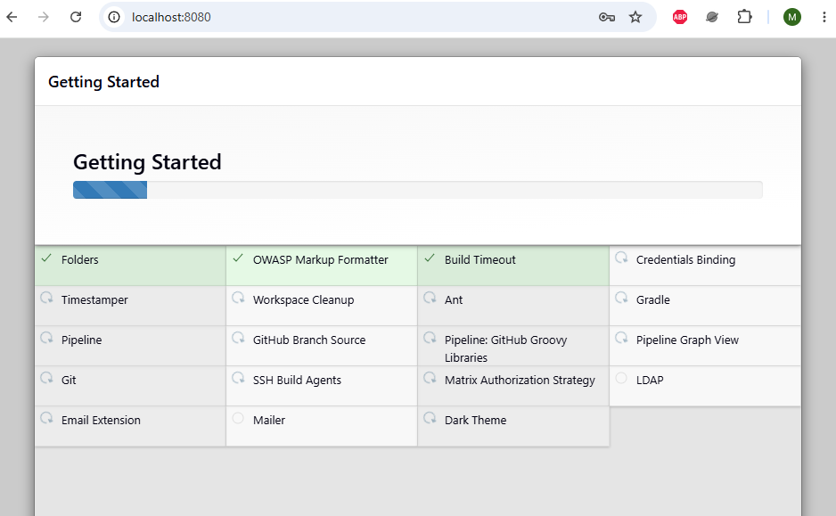
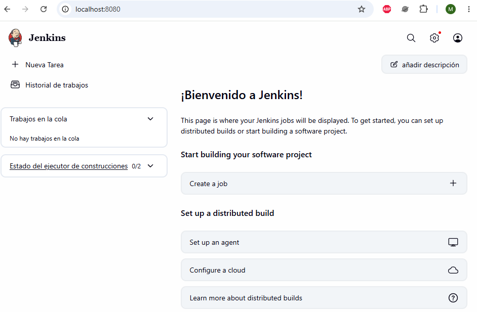
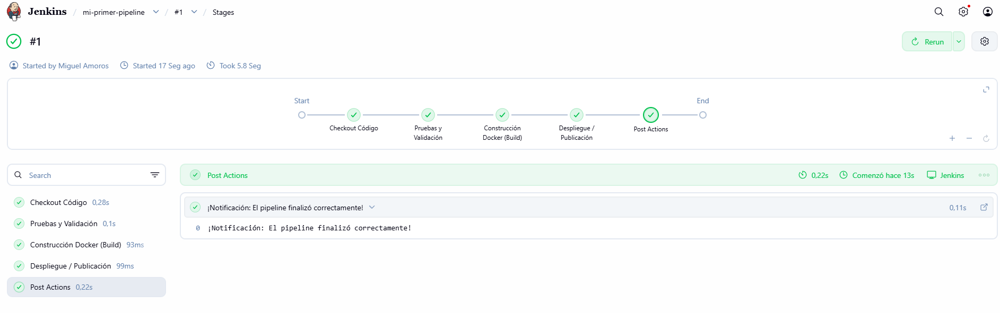
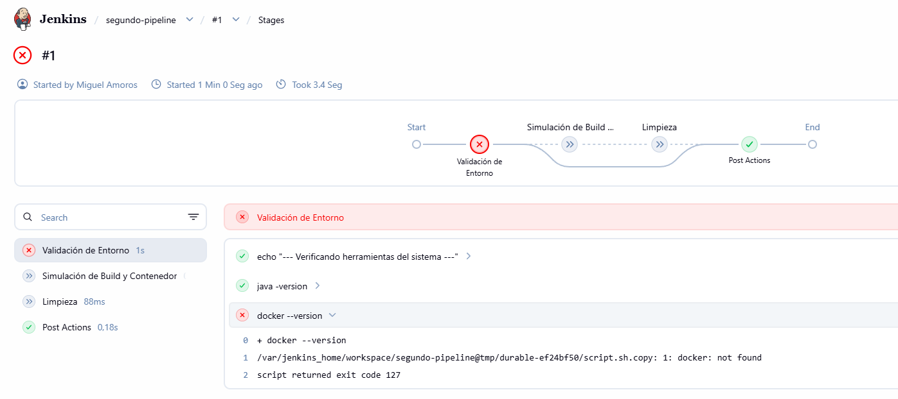
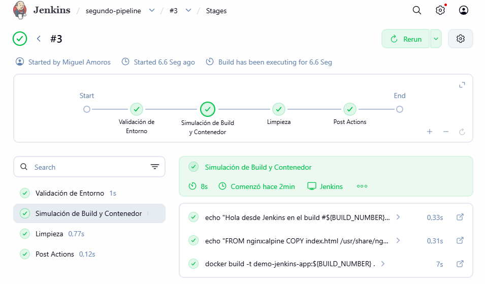
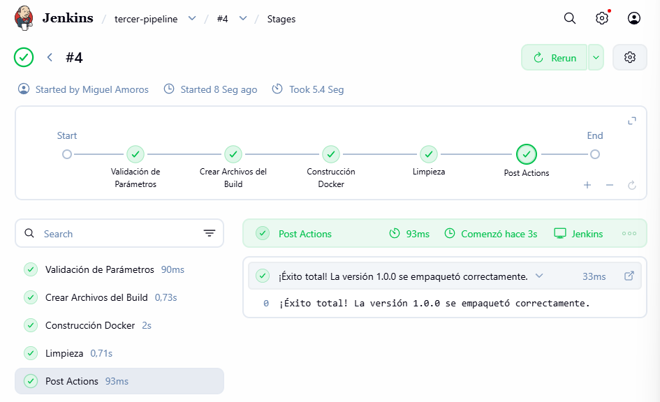
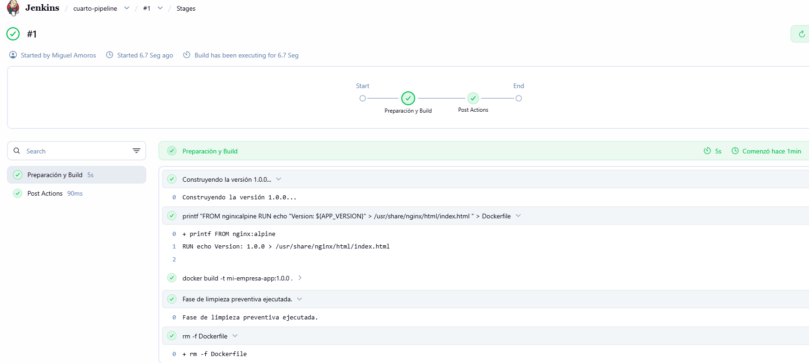
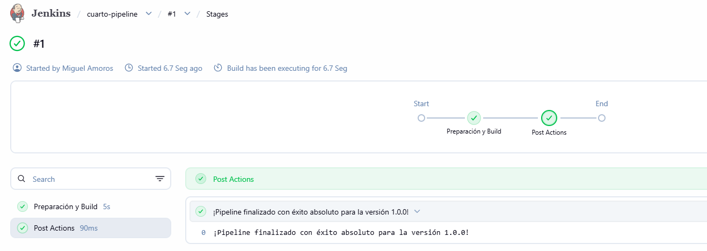

# LAB 10: Jenkins en Docker y Pipeline Declarativo (Jenkinsfile)

```bash
+---------------------------------------------------------------------------------------------------+
|                        ARQUITECTURA DE INTEGRACIÓN CONTINUA (JENKSIN & DOCKER)                    |
+---------------------------------------------------------------------------------------------------+

                        [ Tu Ordenador / Host ]
                                │
                                ▼ (Puerto 8080)
                        +───────────────────────────────────+
                        |       Contenedor `jenkins-server` |
                        |       (Usuario con grupo Docker)  |
                        +─────────────────┬─────────────────+
                                        │
                                        │ (Usa el socket montado sin restricciones de root)
                                        ▼
                        +───────────────────────────────────+
                        |     Demonio Docker del Host       |
                        |     (Ejecuta `docker build`)      |
                        +─────────────────┬─────────────────+
                                        │
                                        ▼
                            [ Imagen Creada: demo-jenkins-app ]
```

## Table of contents

- [Ejercicio](#ejercicio)
- [Instalacion Jenkins](#instalacion-jenkins)
- [Jenkinsfile](#jenkinsfile)
- [Pipeline real](#pipeline-real)
- [Pipeline con parametros y credenciales](#pipeline-con-parametros-y-credenciales)
- [Pipeline con Control de Errores y Entornos](#pipeline-con-control-de-errores-y-entornos)
- [Resumen](#resumen)
- [Chuleta](#chuleta)
- [Author](#author)

## Ejercicio

+ En el mundo real, un ingeniero DevOps no compila ni despliega las aplicaciones a mano. Se apoya en sistemas de Integración Continua y Despliegue Continuo (CI/CD) para automatizar todo el proceso desde que el desarrollador hace un git push hasta que la aplicación llega a producción.

+ ¿Qué vamos a construir en este laboratorio?
    - Desplegar Jenkins mediante Docker: Levantaremos un servidor Jenkins persistente y autónomo usando un contenedor Docker en local.
    - Crear un Pipeline Declarativo (Jenkinsfile): Escribiremos un archivo de configuración en la raíz del proyecto que defina las fases (stages) estándar de la industria:
        + **Checkout:** Descargar el código fuente del repositorio.
        + **Test / Linter:** Validar que la sintaxis y las pruebas del código son correctas.
        + **Build:** Construir la imagen Docker de la aplicación.
        + **Publish (Opcional simulado):** Subir la imagen a un registro.

## Instalacion Jenkins

+ Imagina a Jenkins como el director de una orquesta o el "empleado hiperactivo" que trabaja 24/7 en la empresa:
    - El problema: Los desarrolladores escriben código y los sysadmins/DevOps preparan la infraestructura. Si cada vez que hay un cambio hay que compilar a mano, pasar tests, empaquetar en Docker y subirlo a un servidor, el proceso es lento y propenso a errores humanos.
    - La solución (Jenkins): Es un servidor de automatización de código abierto. Detecta cuando hay cambios en el repositorio, toma el código, ejecuta una serie de pasos secuenciales de forma automática (crear contenedores, pasar pruebas de seguridad, desplegar) y te avisa si algo falla.

+ En lugar de instalar Jenkins directamente en tu sistema operativo (lo que ensucian las librerías de Java, dependencias, etc.), los profesionales siempre lo ejecutan dentro de un contenedor Docker. Esto nos garantiza aislamiento, limpieza y portabilidad absoluta:

1. **Crear un volumen Docker para persistencia:**  
Jenkins guarda configuraciones, usuarios y credenciales. Si borramos el contenedor sin un volumen, perderíamos todo. Creamos un volumen persistente:
```bash
docker volume create jenkins_home
```

2. **Ejecutar el contenedor de Jenkins:  
Lanza el contenedor oficial de Jenkins LTS (Long-Term Support) mapeando los puertos de la interfaz web (8080) y el puerto de comunicación de agentes (50000):  
```bash
docker run -d \
  --name jenkins-server \
  --restart=on-failure \
  --net=bridge \
  -p 8080:8080 \
  -p 50000:50000 \
  -v jenkins_home:/var/jenkins_home \
  -v /var/run/docker.sock:/var/run/docker.sock \
  jenkins/jenkins:lts-jdk17

docker ps
CONTAINER ID   IMAGE                       COMMAND                  CREATED          STATUS          PORTS                                                                                          NAMES
89b5644433bf   jenkins/jenkins:lts-jdk17   "/usr/bin/tini -- /u…"   13 seconds ago   Up 11 seconds   0.0.0.0:8080->8080/tcp, [::]:8080->8080/tcp, 0.0.0.0:50000->50000/tcp, [::]:50000->50000/tcp   jenkins-server
```
> Nota técnica clave: Fíjate en el volumen -v /var/run/docker.sock:/var/run/docker.sock. Esto le permite a nuestro Jenkins hablar directamente con el Docker del ordenador anfitrión, lo que significa que Jenkins podrá construir contenedores Docker propios (Docker-in-Docker o control del demonio host) dentro de sus tareas de CI/CD. ¡Muy típico en entornos reales!

3. **Obtener la contraseña inicial de desbloqueo:**  
Cuando Jenkins arranca por primera vez, genera una clave de seguridad única para verificar que eres el administrador. Ejecuta este comando para verla:  
```bash
docker logs jenkins-server
```
> Busca en el texto de la consola un bloque largo de letras y números que aparece debajo de un mensaje como: Please use the following password to proceed to installation. Cópialo.

4. **Acceso a la interfaz web:**  
- Abre tu navegador web y entra en: http://localhost:8080
- Pega la contraseña que copiaste del log.
- Selecciona "Install suggested plugins" (Instalar los plugins sugeridos por defecto), ya que incluyen Git, Pipeline, credenciales y gestores básicos que utilizaremos.
- Crea tu usuario administrador local (por ejemplo, usuario admin y una contraseña segura).

  

  


## Jenkinsfile

+ En las empresas modernas, la configuración de Jenkins no se hace haciendo clics a mano en la interfaz web (eso se considera una mala práctica porque no deja rastro ni versión). Se utiliza el concepto de Pipeline as Code (Infraestructura y Automatización como Código):
    - Escribes un archivo de texto llamado Jenkinsfile y lo guardas en la raíz de tu repositorio de Git junto con tu código.
    - Jenkins lee ese archivo y ejecuta de forma automática cada una de las fases (stages) que hayas definido.

+ Aquí tienes la representación visual esquemática de cómo opera un pipeline profesional de Integración Continua desde que el código se valida hasta que se empaqueta:
```bash
+---------------------------------------------------------------------------------+
|                        FLUJO DE PIPELINE CI/CD EN JENKINS                       |
+---------------------------------------------------------------------------------+

   [ 1. SCM / GIT ] ────► ( `git checkout` ) 
                                  │
                                  ▼
                        [ 2. STAGE: Test ] ──────► ( Ejecución de Pruebas / Linter )
                                  │
                                  ▼
                        [ 3. STAGE: Build ] ─────► ( Construcción Imagen Docker )
                                  │
                                  ▼
                        [ 4. STAGE: Deploy ] ────► ( Publicación / Despliegue en K8s )
```

+ **Creando nuestro primer Jenkinsfile Declarativo:** Vamos a escribir nuestro primer archivo de automatización. Este archivo define las fases básicas que toda empresa busca en un perfil DevOps junior/mid:
```Groovy
pipeline {               // 1. Contenedor principal de todo el workflow de CI/CD.
    agent any            // 2. Define DÓNDE se ejecuta. 'any' significa que usará cualquier nodo/agente disponible en Jenkins.
    
    stages {             // 3. Bloque que agrupa todas las fases secuenciales de la tubería.
        
        stage('Checkout Código') {   // 4. Primera fase: Obtener el código fuente.
            steps {
                // En un entorno real, aquí usaríamos:
                // checkout scm
                // Esto clona automáticamente el repositorio de Git de donde vino el Jenkinsfile.
                echo 'Descargando código...'
            }
        }
        
        stage('Pruebas y Linter') {  // 5. Segunda fase: Validar calidad del código.
            steps {
                // Ejemplo real ejecutando comandos en la terminal del contenedor:
                // sh 'npm test' o 'python -m pytest'
                echo 'Ejecutando tests...'
            }
        }
        
        stage('Construcción Docker') { // 6. Tercera fase: Empaquetar la aplicación.
            steps {
                // Ejemplo real usando el socket de Docker del host que montamos antes:
                // sh 'docker build -t mi-empresa/web-app:${env.BUILD_NUMBER} .'
                echo 'Construyendo imagen Docker real...'
            }
        }
    }
    
    post {               // 7. Acciones posteriores basadas en el resultado global del pipeline.
        success {
            echo '¡Pipeline exitoso! Acciones de limpieza o notificación.'
        }
        failure {
            echo '¡El pipeline falló! Enviar alerta (Slack, Email, etc.).'
        }
    }
}
```

+ Crear el Pipeline en la Interfaz de Jenkins:
    - En tu panel de Jenkins (http://localhost:8080), haz clic en New Item (Nuevo elemento).
    - Ponle un nombre descriptivo, por ejemplo: mi-primer-pipeline.
    - Selecciona la opción Pipeline y haz clic en OK.
    - En la configuración del job, baja hasta la sección Pipeline, cambia la definición a Pipeline script from SCM (si lo conectas a Git) o selecciona Pipeline script para probar a pegar directamente el código anterior y pulsar Save.

+ Ejecutar y Validar:
    - Haz clic en Build Now (Construir ahora) y observa en el panel gráfico (Stage View) cómo se van iluminando en verde cada una de las fases que hemos programado.

  


## Pipeline real

+ Vamos a modificar el script para que ejecute acciones reales en la terminal (comandos de sistema, validación de versiones y uso de Docker), que es lo que realmente te van a exigir:
```Groovy
pipeline {
    agent any
    
    stages {
        stage('Validación de Entorno') {
            steps {
                // Comprobamos qué herramientas tenemos disponibles dentro del agente/contenedor
                sh 'echo "--- Verificando herramientas del sistema ---"'
                sh 'java -version'
                sh 'docker --version'
                sh 'git --version'
            }
        }
        
        stage('Simulación de Build y Contenedor') {
            steps {
                // Simulamos la creación de un archivo y su empaquetado real
                sh 'echo "Hola desde Jenkins en el build #${BUILD_NUMBER}" > index.html'
                sh 'echo "FROM nginx:alpine\nCOPY index.html /usr/share/nginx/html/index.html" > Dockerfile'
                
                // Construimos una imagen Docker real usando el demonio del host
                sh 'docker build -t demo-jenkins-app:${BUILD_NUMBER} .'
            }
        }
        
        stage('Limpieza') {
            steps {
                // Buenas prácticas: limpiar artefactos temporales creados durante el build
                sh 'rm -f Dockerfile index.html'
                sh 'docker rmi demo-jenkins-app:${BUILD_NUMBER} || true'
                echo 'Limpieza de entorno completada.'
            }
        }
    }
    
    post {
        success {
            echo '¡El pipeline con comandos de shell reales finalizó con éxito!'
        }
        failure {
            error 'El pipeline falló en alguna de las fases de comandos.'
        }
    }
}
```
  
> Aunque en el comando docker run inicial le pasamos el volumen del socket (-v /var/run/docker.sock:/var/run/docker.sock), el contenedor oficial de Jenkins no tiene el binario ejecutable de Docker instalado dentro. Sabe hablar con el socket del host, pero el comando docker como tal no existe dentro de ese contenedor base.

```bash
# Como vamos a cambiar los permisos de arranque y el grupo del socket, destruimos el contenedor actual (no perderás nada porque los datos están guardados en el volumen jenkins_home que creamos antes):
docker stop jenkins-server
docker rm jenkins-server

# En tu terminal de Linux/macOS, ejecuta este comando para saber qué ID numérico tiene el grupo docker en tu ordenador:
getent group docker | cut -d: -f3

# Lanzar Jenkins indicando el grupo de Docker (--group-add)
docker run -d \
  --name jenkins-server \
  --restart=on-failure \
  --net=bridge \
  -p 8080:8080 \
  -p 50000:50000 \
  -v jenkins_home:/var/jenkins_home \
  -v /var/run/docker.sock:/var/run/docker.sock \
  --group-add $(getent group docker | cut -d: -f3) \
  jenkins/jenkins:lts-jdk17

# 1. Entrar al contenedor de Jenkins con privilegios de root
docker exec -u 0 -it jenkins-server bash

# 2. Instalar el cliente de Docker dentro del contenedor
apt-get update && apt-get install -y docker.io
```
  


## Pipeline con parametros y credenciales

+ Vamos a crear un tercer pipeline mucho más avanzado que simule un caso de uso real de empresa:
    - Preguntará al usuario (mediante parámetros) qué versión de la aplicación quiere empaquetar.
    - Utilizará variables de entorno de Jenkins.
    - Incluirá manejo de errores estructurado.

```Groovy
pipeline {
    agent any
    
    parameters {
        string(name: 'VERSION_APP', defaultValue: '1.0.0', description: 'Versión de la aplicación a empaquetar')
        booleanParam(name: 'EJECUTAR_TESTS', defaultValue: true, description: 'Marcar si se desean ejecutar las pruebas unitarias')
    }
    
    environment {
        APP_VERSION = "${params.VERSION_APP}"
    }
    
    stages {
        stage('Validación de Parámetros') {
            steps {
                echo "Iniciando despliegue de la versión: ${env.APP_VERSION}"
            }
        }
        
        stage('Crear Archivos del Build') {
            steps {
                // Creamos el contenido de app.info
                sh 'echo "App Versión: ${APP_VERSION}" > app.info'
                
                // Escribimos el Dockerfile de forma segura sin usar -e
                sh 'printf "FROM nginx:alpine\nCOPY app.info /usr/share/nginx/html/index.html\n" > Dockerfile'
            }
        }
        
        stage('Construcción Docker') {
            steps {
                // Construimos la imagen utilizando la variable de entorno
                sh 'docker build -t mi-empresa-app:${APP_VERSION} .'
            }
        }
        
        stage('Limpieza') {
            steps {
                sh 'docker rmi mi-empresa-app:${APP_VERSION} || true'
                sh 'rm -f Dockerfile app.info'
            }
        }
    }
    
    post {
        success {
            echo "¡Éxito total! La versión ${env.APP_VERSION} se empaquetó correctamente."
        }
        failure {
            error "El pipeline falló en la ejecución."
        }
    }
}
```
> Groovy vs Bash: En un Jenkinsfile, todo lo que está fuera de un bloque sh se procesa con Groovy. Todo lo que está dentro de sh '...' se ejecuta en el sistema operativo (Bash/sh).  

> Variables de Entorno: Jenkins convierte automáticamente los parámetros definidos en parameters {...} en variables de entorno accesibles mediante ${NOMBRE_DEL_PARAMETRO} dentro de los comandos sh si usas comillas simples.

  

## Pipeline con Control de Errores y Entornos

+ Vamos a ampliar nuestro pipeline avanzado añadiendo un bloque de control de errores (try / catch / finally). Esto demuestra una mentalidad de ingeniería robusta: si el build falla, el sistema no deja la infraestructura sucia:
```bash
pipeline {
    agent any
    
    parameters {
        string(name: 'VERSION_APP', defaultValue: '1.0.0', description: 'Versión a empaquetar')
    }
    
    environment {
        APP_VERSION = "${params.VERSION_APP}"
        IMAGE_NAME = "mi-empresa-app"
    }
    
    stages {
        stage('Preparación y Build') {
            steps {
                script {
                    // Bloque de control robusto en Groovy (try-catch-finally)
                    try {
                        echo "Construyendo la versión ${env.APP_VERSION}..."
                        sh 'printf "FROM nginx:alpine\nRUN echo \"Version: ${APP_VERSION}\" > /usr/share/nginx/html/index.html\n" > Dockerfile'
                        sh "docker build -t ${env.IMAGE_NAME}:${env.APP_VERSION} ."
                    } catch (err) {
                        echo "¡Ocurrió un error crítico durante la construcción!"
                        throw err // Propaga el error para que Jenkins marque el job como fallido
                    } finally {
                        // El bloque 'finally' se ejecuta SIEMPRE, haya éxito o fallo
                        echo "Fase de limpieza preventiva ejecutada."
                        sh 'rm -f Dockerfile'
                    }
                }
            }
        }
    }
    
    post {
        success {
            echo "¡Pipeline finalizado con éxito absoluto para la versión ${env.APP_VERSION}!"
        }
        failure {
            echo "¡Alerta! El pipeline ha fallado. Revisar consola."
        }
    }
}
```

  
  

## Resumen

+ **Asignación de Agente (agent any):** Jenkins busca un nodo ejecutor disponible (puede ser el nodo master o un contenedor esclavo con Docker instalado) para aislar el entorno de compilación.

+ **Interpretación Multilenguaje (Groovy + Bash):** El motor interpreta la sintaxis Groovy del Jenkinsfile y traduce las instrucciones sh '...' en comandos nativos enviados a la terminal de Linux.

+ **Ejecución y Persistencia (Estado & Logs):** Cada etapa actualiza los estados (verde, rojo, amarillo), guarda los logs en disco de forma estructurada y emite los disparadores del bloque post.

+ **parameters { }**: Jenkins lee esta sección al inicializar el job y construye una interfaz gráfica interactiva en la web ("Build with Parameters") para capturar inputs del usuario.
```bash
string(name: 'VERSION_APP', defaultValue: '1.0.0')
```

+ **environment { }**: Mapea y puentea los inputs del usuario hacia variables de entorno seguras que el sistema operativo y el demonio Docker pueden leer sin errores de sintaxis.
```bash
APP_VERSION = "${params.VERSION_APP}"
```

+ **try / catch / finally**: Estructura defensiva de Groovy. El bloque finally se ejecuta de manera infalible aunque el build falle, garantizando limpieza de ficheros.
```bash
sh 'rm -f Dockerfile app.info'
```

## Chuleta

### 1. Estructura Base y Bloques Raíz
* **`pipeline { ... }`**: Contenedor principal y obligatorio que engloba todo el código y la estructura del pipeline declarativo.
* **`agent`**: Define el entorno o nodo de ejecución donde se procesará el pipeline o una fase específica.
  * *Opciones comunes*: `agent any` (cualquier nodo disponible), `agent none` (obliga a definir agente en cada stage).
* **`stages { ... }`**: Bloque contenedor que agrupa todas las fases secuenciales del flujo de trabajo.
* **`stage('Nombre') { ... }`**: Una fase individual dentro del pipeline (ej. *Build*, *Test*, *Deploy*). Organiza visualmente el progreso en la interfaz.
* **`steps { ... }`**: Acciones secuenciales o comandos concretos que se ejecutan dentro de un `stage`.

### 2. Entradas y Variables
* **`parameters { ... }`**: Define entradas interactivas que el usuario debe rellenar al pulsar *"Build with Parameters"* en la interfaz.
  * *Ejemplos*: `string(name: 'VERSION', defaultValue: '1.0.0')`, `booleanParam(name: 'DEBUG', defaultValue: false)`.
* **`environment { ... }`**: Declara variables de entorno accesibles durante todo el pipeline. Ideal para mapear parámetros o credenciales de forma segura.
  * *Ejemplo*: 
    ```groovy
    environment {
        APP_NAME = "mi-servicio"
        TAG = "${params.VERSION}"
    }
    ```

### 3. Control de Flujo y Lógica
* **`when { ... }`**: Directiva condicional que se coloca dentro de un `stage` para decidir si debe ejecutarse o omitirse.
  * *Ejemplos*: `branch 'main'`, `expression { params.DEPLOY == true }`.
* **`script { ... }`**: Permite introducir bloques de código imperativo (sintaxis de Groovy puro) dentro de un pipeline declarativo. Necesario para usar bucles, `if/else` avanzados o bloques de excepciones.

### 4. Control de Errores y Limpieza
* **`try / catch / finally`** (dentro de un bloque `script`):
  * **`try`**: Intenta ejecutar comandos propensos a fallar (como un `docker build`).
  * **`catch (err)`**: Captura el error si algo falla para registrarlo.
  * **`finally`**: Bloque de código que **se ejecuta siempre** (haya éxito o fallo). Fundamental para tareas de limpieza (borrar archivos temporales o contenedores huérfanos).

### 5. Acciones Posteriores (`post`)
* **`post { ... }`**: Bloque que se ejecuta al finalizar el pipeline en función del resultado global:
  * **`always`**: Se ejecuta siempre, sin importar el resultado.
  * **`success`**: Solo si todas las fases terminaron con éxito.
  * **`failure`**: Solo si el pipeline falló en alguna fase.
  * **`unstable`**: Si el build quedó en un estado inestable (ej. tests con advertencias).

### 6. Comandos de Sistema Útiles en los `steps`
* **`echo "mensaje"`**: Imprime información de texto en la consola de Jenkins.
* **`sh 'comando'`**: Ejecuta un comando de la terminal de Linux (Bash) en el agente actual (ej. `sh 'docker --version'`).
* **`error "mensaje"`**: Fuerza el fallo inmediato del pipeline interrumpiendo su ejecución y mostrando un mensaje personalizado.


## Author
+ Miguel — [GitHub](https://github.com/mamoros-dev) · [LinkedIn](https://www.linkedin.com/in/miguel-amoros-moret/)
