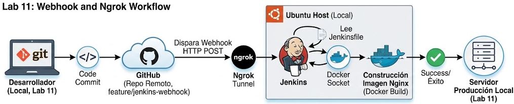
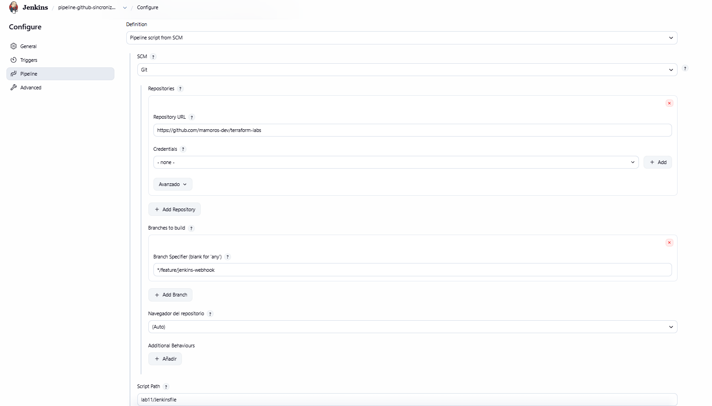
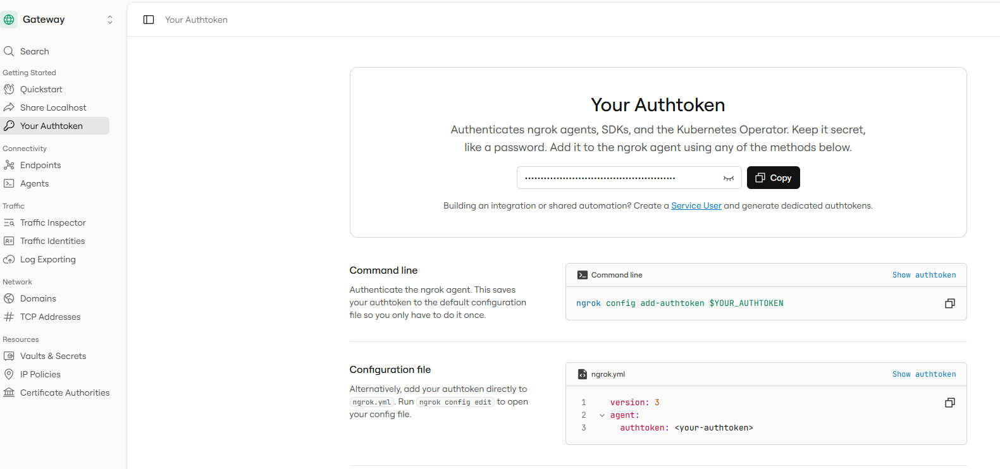
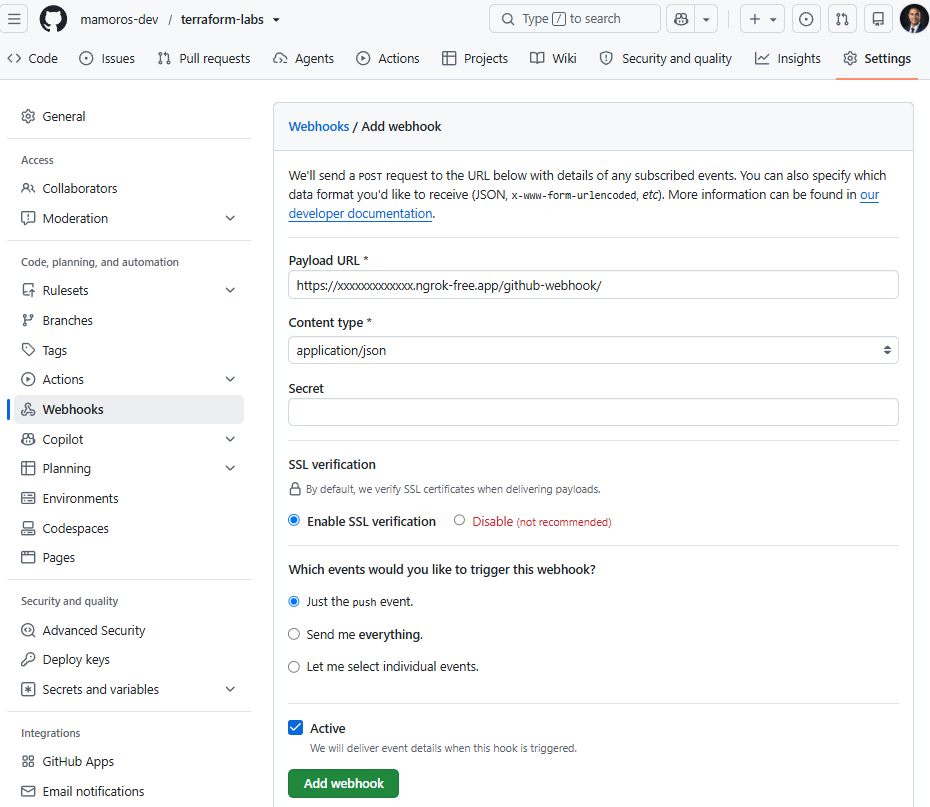
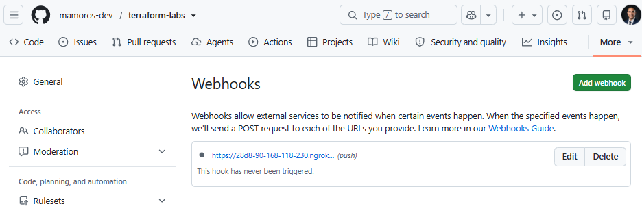
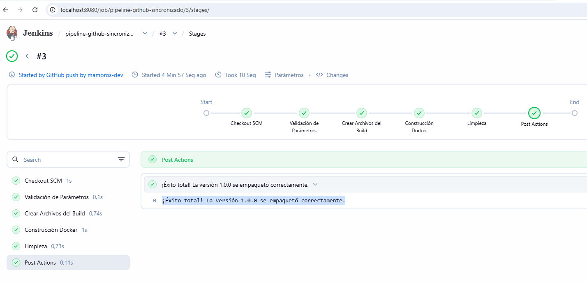
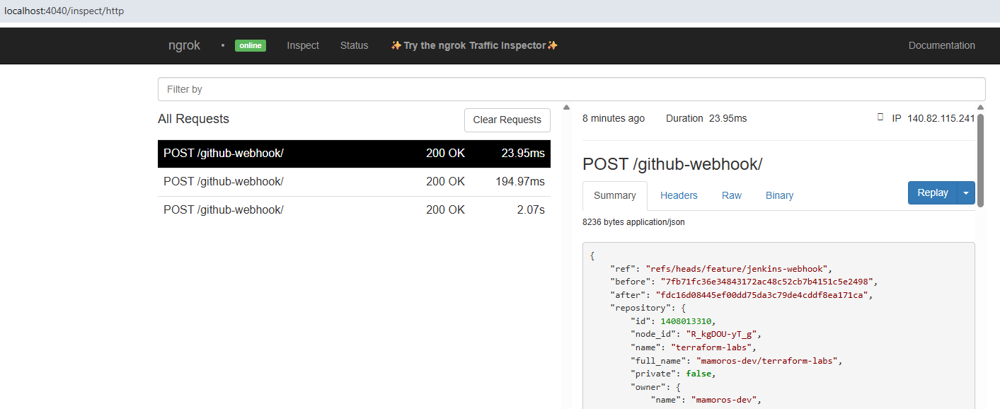
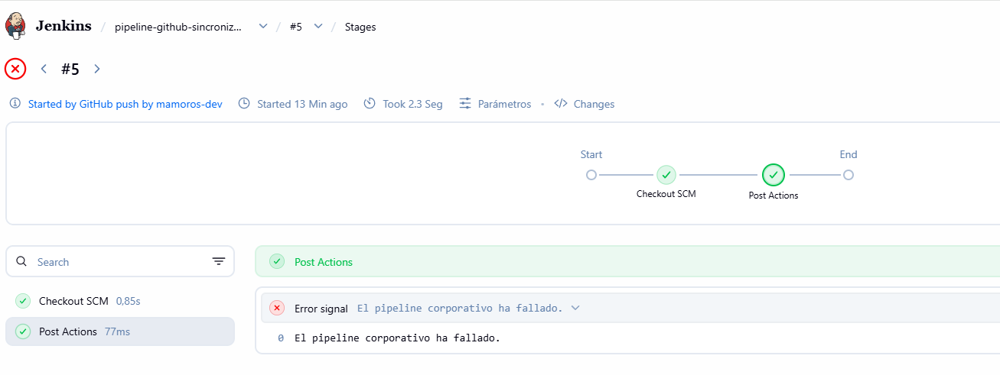
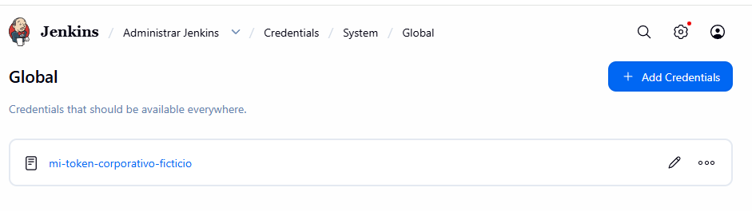
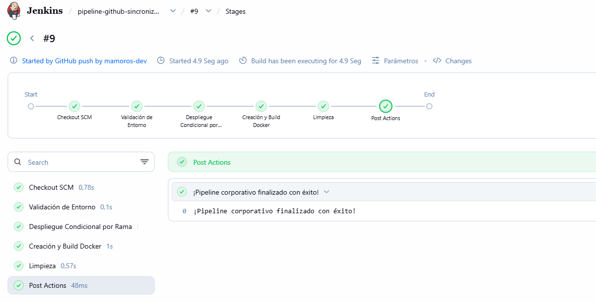

# LAB 11: Automatización con Webhooks de GitHub y Jenkins

  

## Table of contents

- [Ejercicio](#ejercicio)
- [Webhook en GitHub](#webhook-en-github)
- [Verificaciones](#verificaciones)
- [Tecnologias](#tecnologias)
- [Ejemplo Empresa](#ejemplo-empresa)
- [Author](#author)

## Ejercicio

+ Una vez que ya sabemos programar pipelines robustos en Jenkins de forma manual, el siguiente paso natural en una empresa es eliminar la intervención humana.
+ En el Lab 11 aprenderemos a:
    - Configurar un Webhook en tu repositorio de GitHub para que avise a tu Jenkins local cada vez que hagas un git push.
    - Configurar la autenticación segura (Tokens de acceso personal / SSH Keys) para que Jenkins descargue automáticamente el código de tu rama.
    - Disparar el build de forma totalmente autónoma.

+ **Instalar el plugin de GitHub en Jenkins:**  
    - Para que Jenkins sepa entender los eventos de GitHub, asegúrate de tener el plugin instalado:Entra en tu panel de Jenkins (http://localhost:8080).
    - Ve a Manage Jenkins (Gestionar Jenkins) > Plugins > Available plugins.
    - Busca GitHub Integration o GitHub Plugin, márcalo y pulsa Install (instalar sin reiniciar).


+ **Crear un Pipeline basado en SCM (Git):**  
    - En lugar de escribir el código directamente en la interfaz de Jenkins, ahora le diremos a Jenkins que lea el Jenkinsfile directamente de tu repositorio de Git:
        + Crea un archivo llamado Jenkinsfile en la raíz de tu proyecto local con el código robusto que hicimos en el Lab 10.
        + Haz commit y push de esta rama a tu GitHub (git push origin feature/lab11-webhooks-github).En Jenkins, crea un New Item de tipo Pipeline, llámale pipeline-github-sincronizado.
        + En la configuración del job, baja hasta la sección Pipeline:
            - En Definition, cambia a Pipeline script from SCM.
            - En SCM, selecciona Git.
            - En Repository URL, pega la URL de tu repositorio de GitHub (ej: https://github.com/mamoros-dev/tu-repo.git
            - En Branch Specifier, pon */feature/lab11-webhooks-github.
            - En Script Path, deja Jenkinsfile o la ruta de él lab-11/Jenkinsfile.
        + Pulsa Save.

+ **Configurar el disparador de Webhook (Build triggers):**  
    - En la configuración de ese mismo job en Jenkins:
        + Busca la sección Build Triggers (Disparadores de construcción).
        + Marca la casilla GitHub hook trigger for GITScm polling.
        + Esto le indica a Jenkins que quede a la escucha de las notificaciones silenciosas que lleguen desde GitHub.

  

## Webhook en GitHub
+ Para que GitHub sepa la dirección de tu Jenkins:
    - Vas a tu repositorio en la web de GitHub -> Settings (Configuración) -> Webhooks -> Add webhook.
    - En Payload URL, normalmente se pondría la IP pública de tu servidor Jenkins seguida de /github-webhook/ (por ejemplo: http://<tu-ip-publica>:8080/github-webhook/).
> Nota para entorno local: Como estás en local, si no usas una herramienta de túnel como ngrok para exponer tu puerto 8080 a internet, GitHub no podrá hacer ping a tu localhost. ¡Pero no te preocupes! En los entornos de producción reales corporativos, Jenkins está desplegado en servidores internos con IP alcanzable o tras un balanceador con dominio propio.

### Exponer tu Jenkins local a Internet de forma segura con Ngrok

+ Cuando desarrollas en local (localhost:8080), tu máquina está aislada en tu red privada. Ningún servicio de internet (como GitHub) puede enviar peticiones a tu ordenador porque no tiene una dirección pública accesible.
    - **El problema:** Exponer tu puerto 8080 directamente abriendo puertos en el router de tu casa (port forwarding) es inseguro y peligroso.
    - **La solución (ngrok):** Funciona como un túnel proxy inverso seguro. Crea una conexión cifrada de salida (TLS/HTTPS) desde tu ordenador hacia los servidores en la nube de ngrok. Cuando GitHub quiere hablar con tu Jenkins, le manda la petición al dominio público de ngrok, y ngrok la encripta, la pasa por el túnel privado y la entrega de forma limpia y segura a tu localhost:8080.
    - **Seguridad:** Solo expone el puerto exacto que tú le indiques (en este caso el 8080), y toda la comunicación va cifrada con HTTPS. Además, hoy en día ngrok requiere una cuenta gratuita (con un registro rápido en su web) para autenticar los túneles, lo que añade una capa de control de identidad.


#### Por docker

+ Creamos una cuenta gratuita en **NGROK** y seguimos estos pasos:
    - Entra en tu panel y busca la sección de configuración.
    - Localiza la opción 'Your Authtoken'
    - Copia tu Token
    - Lanzamos contenedor docker con el tunel http al puerto donde tenemos jenkins 8080:
    ```bash
    docker run --rm -it --net=host ngrok/ngrok http 8080 --authtoken TU_TOKEN_REAL
    ```
    > El flag --net=host le permite al contenedor de ngrok comunicarse directamente con el puerto 8080 de tu localhost

  

+ Veremos una pantalla con la url Forwarding que nos servirá para configurar el webhook:
```bash
ngrok                                                                                                                                                                                           
Jev is on ngrok.  
Session Status online                                                                                                                                                               
Account                       isx46410800 (Plan: Free)                                                                                                                                                            
Update                        update available (version 3.39.11, Ctrl-U to update)                                                                                                                                
Version                       3.39.8                                                                                                                                                                              
Region                        Europe (eu)                                                                                                                                                                         
Latency                       129ms                                                                                                                                                                               
Web Interface                 http://0.0.0.0:4040                                                                                                                                                                 
Forwarding                    https://xxxxxx.ngrok-free.app -> http://localhost:8080                                                                                                                 
Connections                   ttl     opn     rt1     rt5     p50     p90                                                                                                                                         
                              0       0       0.00    0.00    0.00    0.00 
```


#### Por bash

+ Si estás en Linux (Ubuntu/Debian), ngrok provee un repositorio oficial seguro de APT:
```Bash
curl -s https://ngrok-agent.s3.amazonaws.com/ngrok.asc \
  | sudo tee /etc/apt/trusted.gpg.d/ngrok.asc >/dev/null
echo "deb https://ngrok-agent.s3.amazonaws.com buster main" \
  | sudo tee /etc/apt/sources.list.d/ngrok.list
sudo apt update && sudo apt install ngrok
```

+ Después, configuras tu token en tu terminal:
```Bash
ngrok config add-autotoken <TU_AUTOTOKEN>
```
+ Si no tienes ngrok instalado en tu máquina, puedes levantarlo rápidamente con Docker o descargarlo. Si usas Docker, puedes correr un túnel temporal, o simplemente descargar el binario de ngrok:
```bash
ngrok http 8080
```
+ Ngrok te devolverá una pantalla con una Forwarding URL pública que se verá más o menos así:
```bash
https://a1b2-c3d4.ngrok-free.app
```
+ Copia esa URL. Esa será la dirección pública que usaremos para que GitHub hable con tu Jenkins.

### Webhook github

+ **Configurar el Webhook en GitHub**:
    - Ve a tu repositorio en GitHub y entra en Settings > Webhooks > Add webhook.
    - En Payload URL, pega tu URL de ngrok añadiendo al final exactamente /github-webhook/ (por ejemplo: [https://tu-url.ngrok-free.app/github-webhook/](https://tu-url.ngrok-free.app/github-webhook/)).
    - En Content type, selecciona application/json.
    - En los eventos, selecciona "Just the push event" y pulsa Add webhook.
    > Cómo verificar: Comprueba que en la lista de webhooks de GitHub aparece un punto verde al lado de tu URL.

+ **Activar el disparador en tu Job de Jenkins**:
    - Entra en tu panel de Jenkins (http://localhost:8080) y abre la configuración de tu pipeline.
    - En la sección Build Triggers, marca la casilla "GitHub hook trigger for GITScm polling".
    - Guarda los cambios.

+ **Realizar la prueba de fuego con un Push**:
    - Modifica ligeramente el archivo Jenkinsfile en tu rama local.
    - Haz commit y push a tu repositorio
    > Cómo verificar: Observa la terminal donde corre ngrok para ver la petición HTTP entrante con código 200 OK, y revisa tu panel de Jenkins para comprobar que el build se ha disparado solo.

  

## Verificaciones

+ Hacemos commit y push a la rama del trigger Jenkins - Github:
  

+ Vemos los steps:
  

+ Vemos los logs de ngrok en local:
  
> Comunicación exitosa: El túnel de Ngrok ha recibido la petición HTTP POST enviada desde los servidores de GitHub en la nube y la ha entregado correctamente a través de tu puerto local hasta el contenedor de Jenkins (http://localhost:8080/github-webhook/).

## Tecnologias

Cómo colaboran las tecnologías en este flujo de CI/CD
+ **Tu Repositorio Local (Git) y GitHub:**
    -  Tú escribes el código (Jenkinsfile) en tu ordenador y lo subes con git push. GitHub actúa como la "fuente de la verdad" centralizada que almacena la versión oficial del código.

+ **El Webhook de GitHub:**
    - Cuando GitHub recibe tu git push, detecta que hay un evento configurado. En lugar de quedarse esperando, emite una notificación HTTP ultrarrápida (un payload en formato JSON) hacia fuera.

+ **El Túnel Inverso (Ngrok):**
    - Como tu Jenkins vive protegido en tu ordenador local (localhost:8080), GitHub no puede verlo directamente. Ngrok intercepta esa petición que viene de internet y la canaliza de forma segura a través de un túnel cifrado hacia tu puerto local.

+ **El Plugin de GitHub en Jenkins:**
    - Jenkins recibe la petición de Ngrok gracias al endpoint /github-webhook/. El servidor de Jenkins se despierta, comprueba qué repositorio y rama han cambiado, y se conecta por Git para clonar el código actualizado.

+ **El Motor de Jenkins (Jenkinsfile):**
    - Jenkins lee el archivo paso a paso: valida parámetros, ejecuta comandos de shell mediante Bash (printf, docker build), levanta la imagen del contenedor en tu motor Docker local y te devuelve el resultado en verde en su panel.

## Ejemplo Empresa

+ **Práctica de Empresa: Inyección Segura de Credenciales y Control por Ramas**
+ En un entorno corporativo real, los pipelines nunca usan contraseñas fijas, y además suelen comportarse de forma distinta según la rama sobre la que se esté trabajando (main frente a ramas de desarrollo o feature).
+ Vamos a modificar tu `Jenkinsfile` actual para incorporar dos prácticas empresariales:
    - Uso de un bloque `when` condicional para que una fase solo se ejecute si estamos en una rama específica.
    - Uso de un bloque `credentials` para simular que inyectamos un token de acceso de forma cifrada.

```Groovy
pipeline {
    agent any
    
    parameters {
        string(name: 'VERSION_APP', defaultValue: '1.0.0', description: 'Versión de la aplicación')
    }
    
    environment {
        APP_VERSION = "${params.VERSION_APP}"
        // Simulamos la llamada a una credencial cifrada almacenada en Jenkins
        // (En producción usarías el ID real creado en el gestor de credenciales de Jenkins)
        API_TOKEN = credentials('mi-token-corporativo-ficticio') 
    }
    
    stages {
        stage('Validación de Entorno') {
            steps {
                echo "Desplegando versión: ${env.APP_VERSION}"
                // Comprobamos que la variable de credencial está protegida (Jenkins la enmascara como ***** en los logs)
                script {
                    if (env.API_TOKEN != null) {
                        echo "Credencial corporativa cargada y enmascarada correctamente de forma segura."
                    }
                }
            }
        }
        
        stage('Despliegue Condicional por Rama') {
            // Práctica de empresa: Este stage solo se ejecuta si la rama es main o feature
            wwhen {
                expression { 
                    env.BRANCH_NAME == 'feature/jenkins-webhook' || 
                    env.GIT_BRANCH == 'origin/feature/jenkins-webhook' || 
                    currentBuild.getBuildCauses()[0].shortDescription.contains('feature/jenkins-webhook')
                }
            }
            steps {
                echo "Rama autorizada detectada. Ejecutando tareas específicas de integración..."
                sh 'echo "Compilación validada para entornos de desarrollo/característica."'
            }
        }
        
        stage('Creación y Build Docker') {
            steps {
                sh 'echo "App Versión: ${APP_VERSION}" > app.info'
                sh 'printf "FROM nginx:alpine\nCOPY app.info /usr/share/nginx/html/index.html\n" > Dockerfile'
                sh 'docker build -t mi-empresa-app:${APP_VERSION} .'
            }
        }
        
        stage('Limpieza') {
            steps {
                sh 'docker rmi mi-empresa-app:${APP_VERSION} || true'
                sh 'rm -f Dockerfile app.info'
            }
        }
    }
    
    post {
        success {
            echo "¡Pipeline corporativo finalizado con éxito!"
        }
        failure {
            error "El pipeline corporativo ha fallado."
        }
    }
}
```
> WHEN: Por qué funciona: En lugar de mirar una sola variable, le decimos a Jenkins: "Comprueba si la rama se llama feature/jenkins-webhook, o si empieza por origin/, o incluso mira la descripción del evento que envió GitHub". De esta forma nos aseguramos de que, coja la variable por donde la coja, la detecte y ejecute la fase en verde.

+ Pruebas:
    - Actualiza tu archivo en local
    - Sube los cambios a GitHub
    - Inspecciona la consola de Jenkins
> Entra en tu panel de Jenkins y abre los detalles de la ejecución automática.  
> Cómo verificar: Revisa que la fase "Despliegue Condicional por Rama" se haya ejecutado en verde porque tu rama cumple la condición del filtro when.

  
> > El fallo no tiene nada que ver con el Webhook ni con Ngrok (el disparador funcionó de maravilla y clonó tu repositorio perfectamente). El problema es que en el código de prueba que añadimos pusimos esto: `API_TOKEN = credentials('mi-token-corporativo-ficticio')` 

+ Para que Jenkins pueda usar una credencial real, hay que dar dos pasos:
    - **Crear la credencial en Jenkins:**
        + Vas a tu panel de Jenkins > Manage Jenkins > Credentials > System > Global credentials (unrestricted) > Add Credentials.
        + Seleccionas el tipo (por ejemplo, Secret text o Username with password), le pones un ID único (ej: mi-token-corporativo) y guardas el secreto cifrado.

    - **Llamar a ese ID real en tu Jenkinsfile:**
        + En lugar de usar un nombre inventado, pones el ID exacto que acabas de registrar en Jenkins.

  

+ Lanzamos de nuevo el pipeline y todo ok!
  


## Author
+ Miguel — [GitHub](https://github.com/mamoros-dev) · [LinkedIn](https://www.linkedin.com/in/miguel-amoros-moret/)
