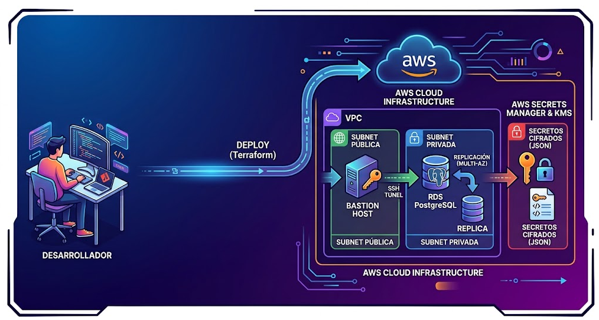

# LAB 12a: Bases de Datos RDS PostgreSQL

  

## Table of contents

- [RDS PostgreSQL](#rds-postgresql)
- [Arquitectura](#arquitectura)
- [Configuracion](#conectividad)
- [Resumen RDS](#resumen-rds)
- [Author](#author)

## RDS PostgreSQL

+ **¿Qué es?:** Es el servicio gestionado de bases de datos relacionales (RDBMS) de Amazon Web Services que ejecuta el motor de código abierto PostgreSQL, liberándote de tareas rutinarias de mantenimiento (parches, aprovisionamiento, backups).

+ **Mejores Características:**
    - **Extensibilidad y Tipos Avanzados:** Soporte nativo para datos semiestructurados (JSONB), búsquedas de texto complejo y extensiones potentes como PostGIS (para datos geográficos/mapas).
    - **Multi-AZ (Alta Disponibilidad):** Crea una réplica síncrona en otra Zona de Disponibilidad. Si el nodo principal falla, AWS realiza un failover automático cambiando las DNS a la réplica en segundos sin intervención manual.
    - **Seguridad y Aislamiento:** Se despliega dentro de una VPC en subnets privadas, protegida por Security Groups y cifrada en reposo mediante claves de KMS.
    - **Recuperación ante Desastres (DR):** Copias de seguridad automáticas con retención configurable y capacidad de restaurar la base de datos a un segundo exacto (Point-in-Time Recovery).

+ ¿Cuándo se usa en empresas?:
    - Aplicaciones transaccionales complejas (OLTP) que exigen un estricto cumplimiento ACID.
    - Sistemas que manejan estructuras de datos flexibles (gracias a JSONB) junto a tablas relacionales tradicionales.
    - Aplicaciones geoespaciales o analíticas a mediana escala.

+ En las arquitecturas empresariales seguras, ninguna base de datos va jamás en subnets públicas.
    - **El diseño:** Desplegaremos una instancia de RDS PostgreSQL dentro de subnets privadas aisladas. Su Security Group solo permitirá tráfico entrante en el puerto 5432 procedente exclusivamente del Security Group de nuestra aplicación o servidores web (nunca abierto a 0.0.0.0/0).
    - **Alta Disponibilidad:** Configuraremos Multi-AZ, lo que significa que AWS mantiene una réplica síncrona en otra zona de disponibilidad por si cae el nodo principal.
    - **Resiliencia:** Programaremos copias de seguridad automáticas (automated backups) y simularemos una restauración a partir de un snapshot.


## Arquitectura

+ Vamos a diseñar una infraestructura limpia que contenga:
    - VPC con rango 10.0.0.0/16.
    - 2 Subnets Públicas (para elementos de entrada como NAT Gateways o ALB si fuera necesario).
    - 2 Subnets Privadas (donde vivirá nuestra base de datos en distintas Zonas de Disponibilidad para cumplir con Multi-AZ).
    - Internet Gateway y Tablas de Rutas.
    - El Security Group y la instancia RDS PostgreSQL que vimos antes.
    - Un clúster RDS PostgreSQL Multi-AZ (un nodo principal activo y un nodo secundario de respaldo en otra zona de disponibilidad por si cae la infraestructura física de AWS).

+ ¿Por qué no se crean EIP y NAT Gateway en este caso?
    - Porque en este laboratorio la base de datos vive aislada en subnets privadas y no necesita salir a internet para nada (los datos de los usuarios se quedan dentro de la VPC). Las NAT Gateways solo se usan si tienes servidores de aplicación (ec2, containers) en subnets privadas que necesiten descargar parches o paquetes de internet. Al no tener máquinas de aplicación todavía, nos ahorramos el coste (las NAT Gateways en AWS son de pago por hora).

+ ¿Qué es el bloque aws_db_subnet_group?
    - Es un requisito obligatorio de AWS para bases de datos RDS. Como una instancia RDS usa la característica Multi-AZ (requiere estar en al menos dos Zonas de Disponibilidad distintas para garantizar alta disponibilidad si cae un centro de datos), AWS necesita saber exactamente en qué subnets privadas puede desplegar el nodo principal y el nodo espejo. Este recurso agrupa esas subnets en un "paquete" que luego se le asigna a RDS.

+ Ficheros:
    - main.tf
    - variables.tf
    - terraform.tfvars
    - outputs.tf

## Configuracion

+ Entra en la consola de AWS, busca el servicio RDS y haz clic en tu instancia (lab12-postgres-prod). Vamos a revisar los puntos críticos que un auditor o un arquitecto comprueba siempre:

+ **Pestaña "Connectivity & security" (Conectividad y Seguridad):**
    - Endpoint y Puerto: Verás que te da una dirección DNS interna (ej: lab12-postgres-prod.xxxxxx.eu-west-1.rds.amazonaws.com) y el puerto 5432. Nota: Fíjate que no tiene IP pública asignada; su accesibilidad es Private, lo que valida que cumple con la seguridad de red que diseñamos.
    - VPC Security Groups: Comprueba que tiene asociado el Security Group restrictivo que creamos (el que solo permite el puerto 5432 desde la propia red interna).

+ **Pestaña "Configuration" (Configuración):**
    - Multi-AZ: Debe marcar Enabled (Habilitado). Esto significa que AWS ha creado automáticamente una réplica en otra zona de disponibilidad y gestiona las réplicas en caliente.
    - Storage Type: Verás que usa discos gp3 (General Purpose SSD), que permiten escalar el rendimiento (IOPS) de forma independiente al tamaño del disco.
    - Backup: Comprueba que la retención de copias de seguridad está activa a 1 días.

## Conectividad

+ Creamos una instancia bastion host en la subnet pública con un par de claves nuevo para poder conectarnos a la base de datos desde esta instancia.

+ Generar el par de claves en tu ordenador (Terminal local):
`ssh-keygen -t ed25519 -C "bastion-lab12" -f ~/.ssh/id_ed25519_bastionhost`  

+ En tu main.tf, le indicamos que cree el recurso en AWS usando exactamente este nuevo archivo público:
```bash
# Recurso en AWS que registra la clave pública del Bastion
resource "aws_key_pair" "bastion_key" {
  key_name   = "${var.project_name}-bastion-key"
  public_key = file("~/.ssh/id_ed25519_bastionhost.pub") # Lee el nuevo archivo público que acabamos de crear
}
```

+ Para que el Bastion Host pueda hablar con la base de datos RDS (que está en la subnet privada), debemos permitir el puerto 5432 en el Security Group de PostgreSQL viniendo del Security Group del Bastion (esta es la buena práctica recomendada en empresas en lugar de abrir rangos de IPs generales):
    - Modifica la regla de ingress de tu aws_security_group.rds_postgres_sg para añadir el origen por ID de security group:
```bash
  ingress {
    description     = "PostgreSQL desde el Bastion Host"
    from_port       = 5432
    to_port         = 5432
    protocol        = "tcp"
    security_groups = [aws_security_group.bastion_sg.id] # <-- Permitimos explícitamente al Bastion
  }
```

+ Una vez que apliques el terraform apply y se levante la instancia, para conectarte por SSH usarás tu clave privada local apuntando explícitamente a ella: `ssh -i ~/.ssh/id_ed25519_bastionhost ec2-user@<IP_PUBLICA_DEL_BASTION>`   
    - Tu ordenador personal: Está en tu casa/oficina (fuera de AWS).
    - El Bastion Host: Está dentro de una subnet pública de tu VPC. Tiene una IP pública y sirve como "puerta de entrada" o puente seguro.
    - La Base de Datos RDS PostgreSQL: Está guardada en una subnet privada, totalmente aislada del exterior. Solo permite que le hablen los componentes que están dentro de la red interna (como nuestro Bastion Host).

+ Como ya estás "dentro" de la red gracias al Bastion Host, el siguiente paso lógico es probar la conectividad y saltar desde el Bastion hasta la base de datos privada para comprobar que responde. Para ello, necesitamos dos cosas en este punto:
    - Instalar el cliente de PostgreSQL en el Bastion Host (para poder lanzar comandos de prueba).
    ```bash
    sudo dnf install -y postgresql15 # amazon linux
    sudo apt update && sudo apt install -y postgresql-client # ubuntu/debian
    ```
    - Obtener el Endpoint de tu base de datos para saber a qué dirección exacta debemos apuntar y conectarnos: `psql -h lab12-databases-postgres-prod.xxxxxxxxx.rds.amazonaws.com -U dbadmin -d empresa_db`
    > -U usuario -d database

+ Escribimos comandos para practicar:
```SQL
-- 1. Creamos la tabla de clientes
CREATE TABLE clientes (
    id SERIAL PRIMARY KEY,
    nombre VARCHAR(100) NOT NULL,
    email VARCHAR(150) UNIQUE NOT NULL,
    creado_en TIMESTAMP DEFAULT CURRENT_TIMESTAMP
);

-- 2. Creamos la tabla de pedidos con una clave foránea (Foreign Key)
CREATE TABLE pedidos (
    id SERIAL PRIMARY KEY,
    cliente_id INT REFERENCES clientes(id) ON DELETE CASCADE,
    total NUMERIC(10, 2) NOT NULL,
    estado VARCHAR(50) DEFAULT 'pendiente'
);
```
> CREATE TABLE clientes (...): Define una tabla nueva llamada clientes.  
> SERIAL: Es un tipo de dato especial de PostgreSQL que autoincrementa un número entero automáticamente ($1, 2, 3...$) para servir como identificador único.  
> PRIMARY KEY: Garantiza que cada fila de la tabla sea única y no se repita ese ID.  
> UNIQUE: Obliga a que el correo electrónico no pueda repetirse en dos clientes distintos.  
> REFERENCES clientes(id) ON DELETE CASCADE: Esto es clave para una base de datos relacional. Crea una Clave Foránea (Foreign Key) que conecta la tabla de pedidos con la de clientes. El ON DELETE CASCADE significa que si borramos a un cliente, la base de datos borrará automáticamente todos sus pedidos asociados para evitar datos huérfanos.  
> JOIN: Se usa para "cruzar" información de dos o más tablas relacionadas en una sola consulta, uniendo las filas que coincidan por su ID común.  


```SQL
-- Insertamos un cliente
INSERT INTO clientes (nombre, email) VALUES ('Ana García', 'ana.garcia@empresa.com');

-- Insertamos un pedido asociado a ese cliente (ID 1)
INSERT INTO pedidos (cliente_id, total, estado) VALUES (1, 150.50, 'completado');


SELECT c.nombre, c.email, p.total, p.estado 
FROM clientes c 
JOIN pedidos p ON c.id = p.cliente_id;
```

```SQL
-- 1. Añadimos una columna de tipo JSONB a la tabla de clientes
ALTER TABLE clientes ADD COLUMN preferencias JSONB;

-- 2. Actualizamos al cliente con datos en formato JSON flexible
UPDATE clientes 
SET preferencias = '{"tema": "oscuro", "notificaciones": true, "idioma": "es"}' 
WHERE id = 1;
```
> JSONB: El formato JSON binario de PostgreSQL. A diferencia de guardar texto plano, Postgres lo comprime e indexa para que puedas hacer consultas ultrarrápidas dentro de las propiedades del JSON sin romper el esquema estricto de la tabla.  

```SQL
SELECT nombre, preferencias->>'idioma' AS idioma_usuario 
FROM clientes 
WHERE preferencias->>'tema' = 'oscuro';
empresa_db=> SELECT nombre, preferencias->>'idioma' AS idioma_usuario 
FROM clientes 
WHERE preferencias->>'tema' = 'oscuro';
   nombre   | idioma_usuario 
------------+----------------
 Ana García | es
(1 row)
```

## Resumen RDS

- Para dar por concluido este Lab 12a con éxito, aparte de saber conectarte y lanzar comandos SQL, en una entrevista técnica o en el trabajo te van a exigir conocer los siguientes conceptos de AWS RDS:
    + **Alta Disponibilidad (Multi-AZ):**
        - Qué es: Ya lo hemos configurado. Significa que hay una instancia principal en una zona de disponibilidad y una instancia espejo (Standby) en otra zona distinta.
        - Para qué sirve: Si se quema el centro de datos principal de AWS, RDS realiza un Failover automático en pocos minutos redirigiendo el DNS al nodo secundario sin pérdida de datos.

    + **Escalabilidad (Storage y Compute):**
        - Puedes escalar verticalmente la potencia de la máquina cambiando el instance_class (ej: pasar de t3.micro a t3.medium).
        - El almacenamiento (que pusimos en gp3) puede auto-escalar si se llena la base de datos sin necesidad de intervención manual.

    + **Mantenimiento y Actualizaciones (Maintenance Windows):**
        - AWS aplica parches de seguridad automáticamente en las ventanas de mantenimiento que configures. Es vital saber planificarlas para que no coincidan con las horas críticas de tráfico de la empresa.

    + **Copias de Seguridad y Recuperación (Automated Backups & Point-in-Time Recovery):**
        - RDS hace snapshots automáticos diarios del volumen y guarda los registros de transacciones (WAL logs). Esto te permite restaurar la base de datos exactamente al estado en el que estaba a un minuto y segundo concreto (ej: "recupera la BD tal y como estaba hoy a las 09:14:22" si alguien borró una tabla por error).

## Author
+ Miguel — [GitHub](https://github.com/mamoros-dev) · [LinkedIn](https://www.linkedin.com/in/miguel-amoros-moret/)
