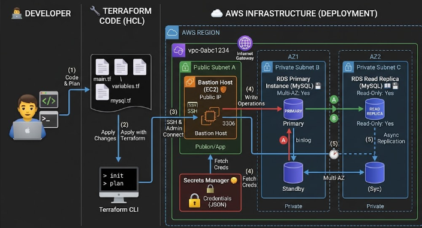

# LAB 12b: RDS MySQL y comparativa de motores relacionales.

  

## Table of contents

- [RDS MYSQL](#rds-mysql)
- [Arquitectura](#arquitectura)
- [Configuracion](#configuracion)
- [conectividad](#conectividad)
- [Read Replica](#read-replica)
- [Resumen RDS MySQL](#resumen-rds-mysql)
- [Author](#author)

## RDS MySQL

+ Es un servicio administrado de bases de datos relacionales en la nube de AWS que utiliza el motor de código abierto MySQL.
+ Al ser administrado, AWS se encarga automáticamente de las tareas más tediosas y críticas: las copias de seguridad automáticas, los parches de seguridad del sistema operativo y del motor, la monitorización del rendimiento y la gestión de la alta disponibilidad (Multi-AZ), permitiéndote centrarte únicamente en la arquitectura y en los datos.

+ Mejores Características de RDS MySQL
    - **Alta Disponibilidad con Multi-AZ:** Igual que viste en Postgres, puedes desplegar una instancia principal (Primary) en una zona de disponibilidad y una réplica síncrona en otra zona diferente. Si falla el hardware o la zona principal, AWS realiza un Failover automático.
    - **Réplicas de Lectura (Read Replicas):** MySQL destaca por su facilidad para escalar horizontalmente las lecturas. Puedes crear hasta 15 réplicas de lectura asíncronas en la misma región o incluso en regiones de AWS distintas para repartir el tráfico de las aplicaciones web pesadas.
    - **Motores de Almacenamiento (Pluggable Storage Engines):** Tradicionalmente utiliza InnoDB (el motor por defecto que soporta transacciones seguras ACID y claves foráneas), pero permite flexibilidad según el caso de uso.
    - **Escalabilidad de Rendimiento (Discos gp3 y IOPS provisionadas):** Permite separar el crecimiento del almacenamiento del rendimiento, escalando IOPS de forma independiente.

+ ¿Para qué se usa en una empresa? (Casos de Uso Reales)
    - En el mercado laboral te vas a encontrar MySQL en una gran variedad de escenarios, especialmente en:
        + **Ecosistemas CMS (WordPress, Magento, Drupal):** Es el rey indiscutible de internet. Una inmensa mayoría de CMS corporativos, tiendas online y blogs de alta concurrencia corren sobre MySQL.
        + **Aplicaciones web monolíticas y microservicios ligeros:** APIs y backends desarrollados en PHP (Laravel, Symfony), Node.js o Python que requieren una base de datos relacional rápida, muy probada y con una comunidad masiva de resolución de problemas.
        + **Sistemas con alta carga de lectura:** Gracias a la velocidad de sus tablas InnoDB y sus réplicas de lectura, es ideal para portales donde el 90% de las peticiones son consultas de lectura (SELECT) de catálogos, perfiles o contenidos estáticos.

+ Diferencia rápida: MySQL vs PostgreSQL (Lo que te pueden preguntar)
    - **MySQL:** Destaca por su velocidad en lecturas simples, su enorme adopción en la web tradicional (WordPress/PHP) y su simplicidad operativa histórica.
    - **PostgreSQL:** Destaca por su estricto cumplimiento de los estándares SQL, su potencia con datos complejos (como los campos JSONB que vimos en el lab anterior) y su robustez en transacciones analíticas pesadas.

## Arquitectura

+ Aunque acabamos de trabajar con PostgreSQL, en el mundo real te vas a encontrar con entornos que usan MySQL / MariaDB (muy típico en arquitecturas basadas en WordPress, aplicaciones PHP, legadas o sistemas orientados a alta velocidad de lectura simple).

+ Para dominarlo como Cloud Engineer, vamos a:
    - Desplegar una nueva RDS con motor MySQL usando Terraform en nuestra infraestructura existente (en subnets privadas y con alta disponibilidad Multi-AZ).
    - Analizar las diferencias clave de arquitectura y rendimiento entre PostgreSQL y MySQL (tipos de datos, comportamiento de bloqueos, replicación y casos de uso en empresa).
    - Conectarnos a través del mismo Bastion Host para comprobar cómo se administra y se consulta en MySQL.

+ Mantenemos la misma estructura de red impecable, ya que las buenas prácticas de infraestructura no cambian por cambiar de base de datos:
    - Red Aislada (VPC existente): Trabajaremos sobre nuestra infraestructura de red con subnets públicas y privadas en varias zonas de disponibilidad
    - RDS MySQL (Subnets Privadas - Multi-AZ): Desplegaremos nuestra instancia de base de datos MySQL en las subnets privadas, garantizando que:
        - No tenga IP pública (aislada de Internet).
        - Tenga alta disponibilidad real (Multi-AZ con nodo principal y réplica en otra zona).
        - Utilice almacenamiento gp3.
    - Seguridad de Credenciales: Generaremos un secreto específico para MySQL usando un formato JSON similar en AWS Secrets Manager, desacoplando la contraseña del código plano.

## Configuracion

+ Entra en la consola de AWS, busca el servicio RDS y haz clic en tu instancia (lab12-postgres-prod). Vamos a revisar los puntos críticos que un auditor o un arquitecto comprueba siempre:

+ **Pestaña "Connectivity & security" (Conectividad y Seguridad):**
    - Endpoint y Puerto: Verás que te da una dirección DNS interna (ej: lab12-postgres-prod.xxxxxx.eu-west-1.rds.amazonaws.com) y el puerto 5432. Nota: Fíjate que no tiene IP pública asignada; su accesibilidad es Private, lo que valida que cumple con la seguridad de red que diseñamos.
    - VPC Security Groups: Comprueba que tiene asociado el Security Group restrictivo que creamos (el que solo permite el puerto 3306 desde la propia red interna).

+ **Pestaña "Configuration" (Configuración):**
    - Multi-AZ: Debe marcar Enabled (Habilitado). Esto significa que AWS ha creado automáticamente una réplica en otra zona de disponibilidad y gestiona las réplicas en caliente.
    - Storage Type: Verás que usa discos gp3 (General Purpose SSD), que permiten escalar el rendimiento (IOPS) de forma independiente al tamaño del disco.
    - Backup: Comprueba que la retención de copias de seguridad está activa a 1 días.


## Conectividad

+ Conectarse a MySQL a través del Bastion Host: `ssh -i ~/.ssh/id_ed25519_bastionhost ec2-user@<IP_PUBLICA_DEL_BASTION>`

+ Una vez dentro del Bastion, instala el cliente de MySQL (si no lo tienes) y conéctate a la base de datos usando el puerto 3306: `sudo dnf install -y mariadb105` 

+ Para conectarte (reemplaza el endpoint por el de tu Terraform output): `mysql -h lab12-databases-mysql-prod.xxxxx.eu-west-1.rds.amazonaws.com -u adminmysql -p`

+ Crear una estructura relacional limpia (Motor InnoDB): En MySQL, el motor por defecto es InnoDB, el cual soporta transacciones y claves foráneas (ACID). Ejecuta esto en tu consola de MySQL:
```bash
-- Usamos la base de datos creada por Terraform
USE empresa_mysql_db;

-- Creamos tabla de usuarios
CREATE TABLE usuarios (
    id INT AUTO_INCREMENT PRIMARY KEY,
    nombre VARCHAR(100) NOT NULL,
    email VARCHAR(150) UNIQUE NOT NULL,
    activo BOOLEAN DEFAULT TRUE,
    creado_en TIMESTAMP DEFAULT CURRENT_TIMESTAMP
) ENGINE=InnoDB;

-- Creamos tabla de transacciones / compras
CREATE TABLE compras (
    id INT AUTO_INCREMENT PRIMARY KEY,
    usuario_id INT,
    total DECIMAL(10, 2) NOT NULL,
    producto VARCHAR(100),
    CONSTRAINT fk_usuario FOREIGN KEY (usuario_id) REFERENCES usuarios(id) ON DELETE CASCADE
) ENGINE=InnoDB;
```

+ Insertar datos y hacer pruebas típicas de rendimiento/consultas
```SQL
-- Insertar datos
INSERT INTO usuarios (nombre, email) VALUES ('Carlos Pérez', 'carlos.perez@empresa.com');
INSERT INTO compras (usuario_id, total, producto) VALUES (1, 299.99, 'Licencia Software Cloud');

-- Consultar con agregaciones (muy común en reportes corporativos)
SELECT u.nombre, COUNT(c.id) AS total_compras, SUM(c.total) as dinero_gastado
FROM usuarios u
LEFT JOIN compras c ON u.id = c.usuario_id
GROUP BY u.id, u.nombre;
```

+ El equivalente a JSON en MySQL: Columnas tipo JSON. Igual que vimos que PostgreSQL tiene un superpoder con JSONB, MySQL (a partir de la versión 5.7 y 8.0) también soporta nativamente el tipo de dato JSON para guardar configuraciones semiestructuradas:
```SQL
-- 1. Añadimos una columna JSON a la tabla usuarios
ALTER TABLE usuarios ADD COLUMN configuracion JSON;

-- 2. Insertamos un objeto JSON en un usuario
UPDATE usuarios 
SET configuracion = '{"notificaciones_email": true, "zona_horaria": "Europe/Madrid"}' 
WHERE id = 1;

-- 3. Consultar extrayendo datos del JSON usando la sintaxis de flecha de MySQL
SELECT nombre, configuracion->>'$.zona_horaria' AS zona 
FROM usuarios 
WHERE configuracion->>'$.notificaciones_email' = 'true';
+---------------+---------------+
| nombre        | zona          |
+---------------+---------------+
| Carlos Pérez  | Europe/Madrid |
+---------------+---------------+
1 row in set (0.003 sec)
```

## Read Replica

+ Una Read Replica es una base de datos totalmente funcional a nivel de motor, pero su rol a nivel de almacenamiento está en modo de solo lectura (Read-Only).
+ Si intentas ejecutar un INSERT, UPDATE, DELETE o un CREATE TABLE, la base de datos rechaza la operación inmediatamente.
+ Se usa única y exclusivamente para recibir peticiones de consulta (SELECT), como por ejemplo mostrar el catálogo de productos de una tienda online, perfiles de usuario o listados de histórico.

+ Si RDS permite hasta X número de réplicas, ¿para qué se usan tantas?
    - Si miles de usuarios consultan los productos a la vez, una sola base de datos colapsaría la CPU.
    - Lo que se hace es distribuir la carga de lectura (Load Balancing) entre múltiples réplicas. Por ejemplo, pones 5 o 10 réplicas detrás de un balanceador de carga (ALB o mediante lógica de la aplicación), de forma que las peticiones de lectura se reparten entre todas ellas, protegiendo a la base de datos principal para que solo se encargue de escribir los datos nuevos.

+ ¿Se pueden crear por la interfaz web (AWS Console) o solo por Terraform?
    - Por Terraform: Es lo ideal para entornos profesionales, automatización e infraestructura como código (IaC).
    - Por la consola web de AWS: Si alguna vez estás en una emergencia en producción o quieres hacerlo a mano:
        + Vas al servicio RDS en la consola de AWS.
        + Haces clic en Databases y seleccionas tu base de datos principal (mysql-prod).
        + Vas arriba a la derecha al menú desplegable Actions (Acciones).
        + Seleccionas Create read replica (Crear réplica de lectura).
        + Asignas el nombre, seleccionas la clase de instancia y haces clic en crear. ¡Así de fácil!

+ ¿En qué casos necesitamos crear más réplicas?
    - Cuando el rendimiento de lectura disminuye y la CPU de tu base de datos principal (o de tu única réplica) se dispara por exceso de consultas SELECT.
    - Cuando necesitas baja latencia global (Multi-Region Read Replicas): Si tu base de datos principal está en Europa (Irlanda) pero tienes muchos usuarios en América o Asia, puedes crear una réplica de lectura en la región de AWS de Virginia o Tokio para que los usuarios de esos continentes lean los datos locales ultrarrápidos sin cruzar medio mundo.

+ Si en la principal se añade un dato nuevo. La replicación asíncrona:
    - Un usuario hace una compra o se registra (escritura en la base de datos principal).
    - La principal guarda el dato en su disco y confirma la transacción al usuario.
    - En segundo plano, de forma asíncrona, la principal envía un flujo de registros de cambios (binlog en MySQL) a la réplica.
    - La réplica los procesa y los aplica en su propio almacenamiento.
    - ¿Cuánto tarda? Normalmente milisegundos (replication lag casi imperceptible), pero ojo: en momentos de muchísimo tráfico o escrituras masivas en la principal, la réplica puede sufrir un ligero retraso (lag). Las aplicaciones que leen de la réplica deben estar diseñadas sabiendo que existe esa fracción de segundo de diferencia (por ejemplo, si te registras y vas instantáneamente a tu perfil, si caes en una réplica muy lenta podrías tardar un segundo en verte, aunque en el 99% de los casos es inmediato).


+ Paso 1: Añadir el recurso de la Réplica en Terraform `main.tf`:
```bash
# --- RÉPLICA DE LECTURA DE MYSQL ---
resource "aws_db_instance" "mysql_read_replica" {
  identifier             = "${var.project_name}-mysql-read-replica"
  replicate_source_db    = aws_db_instance.mysql_instance.identifier
  
  # Una réplica hereda por defecto la clase de instancia y motor del origen, 
  # pero podemos especificar opciones de almacenamiento o clase si lo deseamos.
  instance_class         = "db.t3.micro"
  storage_type           = "gp3"
  
  # Las réplicas de lectura van por defecto fuera de la VPC principal o en subnets, 
  # pero heredan la red y el security group de manera lógica.
  publicly_accessible    = false
  skip_final_snapshot    = true

  tags = {
    Environment = var.environment
    Role        = "Read-Replica"
  }
}
```
> Ejecuta terraform apply en tu ordenador local para desplegarla. (Tardará unos minutos en sincronizarse con la base de datos principal).

+ Obtendremos el endpoint de la replica e iremos al bastion host, y nos conectaremos de igual manera pero esta vez a la replica y pondremos consultar datos de SELECT:
```bash
mysql -h <ENDPOINT_DE_LA_REPLICA> -u adminmysql -p

SELECT * FROM usuarios WHERE email = 'replica@empresa.com';
```

## Resumen RDS MySQL

+ Optimización y el uso de Índices: En MySQL, el diseño de índices en las columnas por las que se busca habitualmente (INDEX o UNIQUE) es la diferencia entre que una consulta tarde 2 milisegundos o sature la CPU de la instancia.

+ Réplicas de Lectura vs Multi-AZ:
    - Recuerda que el Multi-AZ en RDS se usa para Alta Disponibilidad / Tolerancia a fallos (ante la caída de una zona de AWS).
    - Las Read Replicas en MySQL se usan para Escalabilidad de Rendimiento (sacar el tráfico pesado de consultas SELECT de la base de datos principal y mandarlo a réplicas asíncronas).

+ Migraciones y Dumps: Saber hacer respaldos lógicos rápidos con herramientas como mysqldump desde el Bastion Host:
```bash
mysqldump -h <endpoint> -u adminmysql -p empresa_mysql_db > respaldo.sql
```
> mysqldump es una herramienta de consola que viene con MySQL que hace exactamente eso: se conecta a la base de datos y te escupe un archivo lleno de comandos INSERT y CREATE TABLE. Si algún día necesitas restaurar esa copia en otra base de datos, simplemente le inyectas ese archivo. Es el equivalente al comando pg_dump que se usa en PostgreSQL.

+ ¿Multi-AZ se hace solo?
    - ¡Sí! Es la gran ventaja de RDS. Cuando en tu Terraform pones multi_az = true, tú no tienes que configurar nada más. AWS por debajo crea automáticamente una segunda máquina gemela en otra zona de disponibilidad distinta, sincroniza los datos de forma transparente y vigila la salud del servidor principal. Si el servidor principal se rompe, AWS hace el cambio (Failover) solo.

+ ¿Cómo se crean las réplicas de lectura (Read Replicas)?
    - Las réplicas se crean añadiendo un recurso específico en Terraform de tipo aws_db_instance pero indicándole cuál es la base de datos de origen (replicate_source_db). Por ejemplo:
    ```Terraform
    resource "aws_db_instance" "mysql_replica" {
    identifier             = "${var.project_name}-mysql-replica"
    replicate_source_db    = aws_db_instance.mysql_instance.identifier
    instance_class         = "db.t3.micro"
    skip_final_snapshot    = true
    # Al ser una réplica de lectura, no necesita multi_az propio ni definir password de master
    }
    ```
    > Esto crea un nodo de lectura asíncrono ideal para sacar el trabajo pesado de consultas de los usuarios y aliviar el servidor principal.


## Author
+ Miguel — [GitHub](https://github.com/mamoros-dev) · [LinkedIn](https://www.linkedin.com/in/miguel-amoros-moret/)
