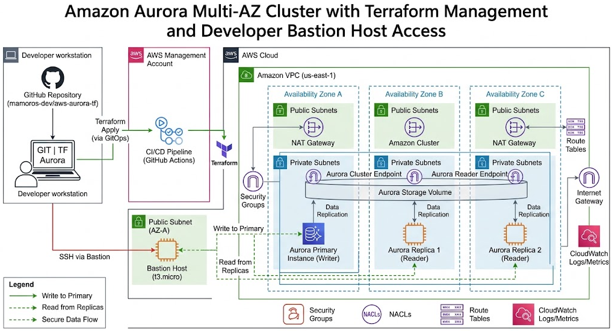

# LAB 12c: Amazon Aurora

  

## Table of contents

- [Aurora Amazon](#aurora-amazon)
- [Arquitectura](#arquitectura)
- [Configuracion](#configuracion)
- [Conectividad](#conectividad)
- [Resumen Amazon Aurora](#resumen-amazon-aurora)
- [Author](#author)

## Aurora Amazon

+ Amazon Aurora es un motor de base de datos relacional totalmente administrado por AWS, compatible con MySQL y PostgreSQL. No es una base de datos tradicional instalada en una máquina virtual, sino un sistema distribuido y optimizado para la nube.
    - **Almacenamiento Distribuido Auto-escalable:** El volumen de almacenamiento crece automáticamente desde 10 GB hasta 128 TB sin necesidad de aprovisionar espacio por adelantado.
    - **Tolerancia a Fallos Masiva (6 copias en 3 AZs):** Los datos se replican automáticamente por 6 copias distribuidas en 3 Zonas de Disponibilidad (AZs) diferentes (dos copias en cada AZ). Puede perder hasta dos copias de datos sin pérdida de escritura y tres sin pérdida de lectura de forma totalmente transparente.
    - **Rendimiento Extremo:** Ofrece hasta 5 veces el rendimiento de MySQL estándar y 3 veces el de PostgreSQL gracias a su arquitectura de almacenamiento desacoplada del motor de computación.
    - **Failover Ultrarrápido:** Si la instancia principal cae, Aurora promueve una réplica de lectura a principal en menos de 30 segundos (mucho más rápido que un RDS tradicional).
    - **Aurora Serverless v2:** Capacidad de escalar el procesamiento y la memoria al instante segundo a segundo basándose en la carga de la aplicación, ideal para entornos con picos de tráfico impredecibles.


+ ¿Para qué se usa en una empresa?
    - Aplicaciones de misión crítica y gran escala: Sistemas financieros, e-commerce globales (Black Friday) y plataformas SaaS con miles de transacciones por segundo.
    - Sistemas que requieren alta disponibilidad real sin penalización de rendimiento: Sustituye con ventaja a las bases de datos locales tradicionales (on-premise) pesadas (Oracle/SQL Server).
    - Arquitecturas con múltiples lectores: Permite escalar hasta 15 réplicas de lectura de baja latencia sincronizadas casi al instante mediante su volumen compartido.


## Arquitectura

+ Mantendremos nuestra red limpia y segura:
    - Bastion Host: En la subnet pública para el acceso de gestión SSH.
    - Aurora Cluster (Subnets Privadas): Un clúster compuesto por un nodo Primary (Escritura) y un nodo Replica (Lectura) compartiendo el mismo volumen de almacenamiento inteligente de Aurora.
    - Security Groups: Controlando el tráfico por el puerto 3306 exclusivamente desde el Bastion Host.

## Configuracion

+ Configuracion en Terraform para Aurora:
```bash
# --- GRUPO DE SUBNETS PARA AURORA ---
resource "aws_db_subnet_group" "aurora_subnet_group" {
  name        = "${var.project_name}-aurora-subnet-group"
  subnet_ids  = aws_subnet.private[*].id
  description = "Grupo de subnets privadas para el cluster de Aurora"

  tags = { Name = "${var.project_name}-aurora-subnet-group" }
}

# --- CLÚSTER DE AMAZON AURORA (MYSQL COMPATIBLE) ---
resource "aws_rds_cluster" "aurora_cluster" {
  cluster_identifier      = "${var.project_name}-aurora-cluster"
  engine                  = "aurora-mysql"
  engine_version          = "8.0.mysql_aurora.3.04.0"
  database_name           = "empresa_aurora_db"
  master_username         = "adminaurora"
  master_password         = "PasswordAurora2026!"
  
  db_subnet_group_name    = aws_db_subnet_group.aurora_subnet_group.name
  vpc_security_group_ids  = [aws_security_group.rds_mysql_sg.id] # Reutilizamos el SG del lab anterior
  
  skip_final_snapshot     = true
  storage_encrypted       = true

  tags = { Environment = var.environment }
}

# --- INSTANCIAS DEL CLÚSTER (Primary + Replica de lectura automática) ---
resource "aws_rds_cluster_instance" "aurora_instances" {
  count              = 2 # Creamos 2 nodos: 1 Primary de escritura y 1 Replica de lectura
  identifier         = "${var.project_name}-aurora-instance-${count.index}"
  cluster_identifier = aws_rds_cluster.aurora_cluster.id
  instance_class     = "db.t3.medium" # Aurora requiere al menos t3.medium o superior
  engine             = aws_rds_cluster.aurora_cluster.engine
  engine_version     = aws_rds_cluster.aurora_cluster.engine_version
}

# --- OUTPUTS PARA LOS ENDPOINTS ---
output "aurora_writer_endpoint" {
  description = "Endpoint de Escritura (Primary) de Aurora"
  value       = aws_rds_cluster.aurora_cluster.endpoint
}

output "aurora_reader_endpoint" {
  description = "Endpoint de Lectura (Reader) de Aurora (balancea automáticamente entre réplicas)"
  value       = aws_rds_cluster.aurora_cluster.reader_endpoint
}
```

## Conectividad

+ Una vez ejecutado terraform apply y levantado el clúster (puede tardar unos minutos):
    - Conéctate al Bastion Host por SSH.
    - Conéctate al nodo de Escritura (Writer Endpoint):
    ```Bash
    mysql -h <AURORA_WRITER_ENDPOINT> -u adminaurora -p
    ```
    > Una vez dentro, puedes crear tablas e insertar datos con total normalidad (INSERT, UPDATE, SELECT).

    - Conéctate al nodo de Lectura (Reader Endpoint):
    ```Bash
    mysql -h <AURORA_READER_ENDPOINT> -u adminaurora -p
    ```
    > Este endpoint es mágico en Aurora: DNS redirige automáticamente las peticiones de lectura entre tus instancias de réplica disponibles de forma balanceada. Si intentas hacer un INSERT aquí, comprobarás que el clúster protege el nodo impidiendo escrituras.

## Resumen Amazon Aurora

+ ¿Qué es?: Es una base de datos relacional de alto rendimiento construida específicamente para la nube, totalmente compatible con MySQL y PostgreSQL.
+ Arquitectura Desacoplada: El motor de computación (CPU/Memoria) está separado del almacenamiento físico. Los datos residen en un volumen distribuido y tolerante a fallos.
+ Tolerancia a fallos sobresaliente: Almacena 6 copias de los datos en 3 zonas de disponibilidad distintas (AZs). Sobrevive a la pérdida simultánea de dos copias sin perder escrituras.
+ Ventajas clave frente a RDS tradicional:
    - Failover automatizado y rapidísimo en menos de 30 segundos.
    - Escalado de almacenamiento automático de 10 GB hasta 128 TB sin cortes.
    - Rendimiento de hasta 5x superior a MySQL estándar.

+ ¿Dónde se ubica?
    - El clúster se despliega dentro de tus Subnets Privadas (repartidas entre la AZ1 y la AZ2 de tu VPC), completamente aisladas de internet y protegidas por los Security Groups.

+ ¿Cómo se distribuyen los nodos y por qué no hay un multi_az = true?
    - En Aurora, el almacenamiento y la computación están separados.
    - El Volumen de Almacenamiento Aurora se extiende de manera automática y transparente por debajo a lo largo de múltiples AZs (creando automáticamente 6 copias de los datos). Por lo tanto, no necesitas activar un flag de Multi-AZ para el almacenamiento: ya viene por defecto y es ultra-resiliente.
    - Las Instancias de Computación (los nodos que tú creas con el count = 2 en Terraform) se reparten automáticamente entre tus dos Zonas de Disponibilidad (AZ1 y AZ2) basándose en las subnets privadas que le pasas al db_subnet_group.
        - El Nodo 1 actúa por defecto como el Writer (Escritura) en la AZ1.
        - El Nodo 2 actúa como Reader (Réplica de lectura automática) en la AZ2.
    - Si la AZ1 cae por completo, Aurora detecta el fallo y promueve instantáneamente el Nodo 2 (o cualquier otra instancia del clúster) a nodo principal en menos de 30 segundos sin pérdida de datos.

## Author
+ Miguel — [GitHub](https://github.com/mamoros-dev) · [LinkedIn](https://www.linkedin.com/in/miguel-amoros-moret/)
