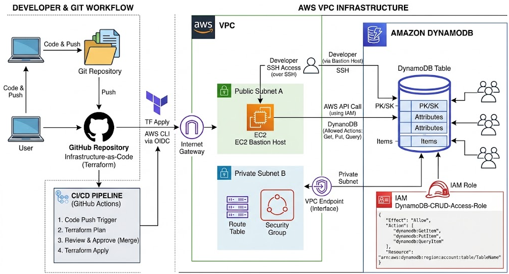

# LAB 12d: Amazon DynamoDB (Bases de datos NoSQL Serverless)

  

## Table of contents

- [DynamoDB](#dynamodb)
- [Arquitectura](#arquitectura)
- [Configuracion](#configuracion)
- [Conectividad](#conectividad)
- [Resumen DynamoDB](#resumen-dynamodb)
- [Author](#author)

## DynamoDB

+ Características:
    - **Base de datos NoSQL de tipo Clave-Valor y Documento:** Diseñada para ofrecer una latencia inferior a 10 milisegundos a cualquier escala.
    - **Completamente Serverless (Sin servidores):** No hay instancias que aprovisionar, parchear o escalar manualmente. AWS gestiona el hardware por debajo de forma totalmente transparente.
    - **Escalabilidad y Rendimiento Masivo:** Soporta picos de tráficos gigantescos (millones de peticiones por segundo) escalando de manera automática el almacenamiento y el rendimiento.
    - **Alta Disponibilidad Nativa:** Los datos se replican automáticamente y de forma sincrónica a través de múltiples Zonas de Disponibilidad (AZs) dentro de una misma región de AWS por defecto.
    - **Modelos de Capacidad de Escritura/Lectura:** Permite elegir entre modo Provisioned (tú defines las unidades de lectura RCU y escritura WCU) o modo On-Demand (pagas estrictamente por cada petición realizada, ideal para cargas impredecibles).

+ ¿Para qué se usa en una empresa real?
    - **Carritos de la compra (Shopping Carts) y catálogos de E-commerce:** Donde se requiere velocidad extrema de lectura/escritura sin bloqueos relacionales.
    - **Gestión de sesiones de usuario y perfiles:** Guardar tokens, preferencias o estados de sesiones en aplicaciones web y móviles a gran escala.
    - **Internet de las Cosas (IoT):** Ingesta masiva y ultra-rápida de telemetría y datos de sensores en tiempo real.

## Arquitectura

+ A diferencia de RDS o Aurora, DynamoDB no vive dentro de tu VPC (es un servicio regional público de AWS al que se accede mediante endpoints seguros de API). En nuestra infraestructura:
    - Mantendremos nuestro Bastion Host y red VPC base.
    - Añadiremos una Tabla de DynamoDB gestionada por Terraform con clave de partición y modo On-Demand.
    - Configuraremos los permisos necesarios mediante políticas de IAM si fuera necesario para que las aplicaciones o instancias accedan a ella de forma segura.


## Configuracion

+ Porque Amazon DynamoDB no vive dentro de tu VPC.
    - Los servicios como RDS, Aurora o tus instancias EC2 necesitan una VPC, subnets privadas y grupos de seguridad porque tú estás gestionando (o AWS gestiona para ti) servidores virtuales con una dirección IP privada dentro de tu red.
    - DynamoDB es un servicio completamente administrado y global/regional de tipo Serverless. No tiene IPs privadas en tu red ni servidores expuestos que debas aislar con un Security Group. Las peticiones a DynamoDB se realizan a través de una API pública segura HTTPS (o mediante VPC Endpoints si estás en entornos corporativos ultra-seguros). Por eso Terraform no te pide vpc_security_group_ids ni db_subnet_group_name.

+ No hay un usuario (admin) ni una contraseña (password) fija que guardar en AWS Secrets Manager para conectarse a DynamoDB. Entonces, ¿cómo se autentica y autoriza el acceso? Se hace mediante IAM (Identity and Access Management) de AWS:
    - Credenciales basadas en roles y políticas: En lugar de poner un usuario y contraseña en tu código o cadena de conexión, cualquier aplicación, script de la CLI o instancia que quiera leer o escribir en la tabla de DynamoDB necesita una política de IAM que le otorgue permisos explícitos (por ejemplo, permisos como `dynamodb:PutItem`, `dynamodb:GetItem`, etc.).
    - Si ejecutas los comandos de la AWS CLI que te pasé en tu máquina o desde el Bastion Host, AWS valida automáticamente que tu usuario o rol de IAM tenga derechos para acceder a esa tabla. Si no tiene permisos, la API te devuelve un error de acceso denegado (`AccessDeniedException`).

## Conectividad

+ Dado que DynamoDB no utiliza un cliente SQL tradicional (mysql o psql), interactuamos con ella a través de la AWS CLI (que puedes probar directamente desde tu máquina o simulando llamadas desde el Bastion Host con permisos IAM):
    - **Insertar un elemento (Put Item):**
    ```bash
    aws dynamodb put-item \
    --table-name lab12-databases-usuarios-table \
    --item '{"UserId": {"S": "user_001"}, "Timestamp": {"N": "1710000000"}, "Nombre": {"S": "Alejandro"}, "Puesto": {"S": "SysAdmin"}}'
    ```
    - **Consultar un elemento por su clave (Get Item):**
    ```bash
    aws dynamodb get-item \
    --table-name lab12-databases-usuarios-table \
    --key '{"UserId": {"S": "user_001"}, "Timestamp": {"N": "1710000000"}}'
    "Item": {
        "UserId": {
            "S": "user_001"
        },
        "Puesto": {
            "S": "SysAdmin"
        },
        "Nombre": {
            "S": "Alejandro"
        },
        "Timestamp": {
            "N": "1710000000"
        }
    }
    ```
    - **Escanear toda la tabla (Scan - cuidado en producción con tablas gigantes):**
    ```bash
    aws dynamodb scan --table-name lab12-databases-usuarios-table
    ```

+ Otros comandos AWS CLI:
    - **Query (Consultar de forma eficiente):** A diferencia del scan (que revisa toda la tabla elemento por elemento gastando muchos recursos), el query busca directamente en la clave. Es obligatorio usarlo si tu tabla tiene clave de partición:
    ```bash
    aws dynamodb query \
    --table-name lab12-databases-usuarios-table \
    --key-condition-expression "UserId = :uid" \
    --expression-attribute-values '{":uid": {"S": "user_001"}}'
    ```
    - **Update Item (Actualizar un atributo sin sobrescribir todo):**
    ```bash
    aws dynamodb update-item \
    --table-name lab12-databases-usuarios-table \
    --key '{"UserId": {"S": "user_001"}, "Timestamp": {"N": "1710000000"}}' \
    --update-expression "SET Puesto = :nuevo_puesto" \
    --expression-attribute-values '{":nuevo_puesto": {"S": "Senior Cloud Engineer"}}' \
    --return-values ALL_NEW
    ```
    - **Delete Item (Borrar un registro específico):**
    ```bash
    aws dynamodb delete-item \
    --table-name lab12-databases-usuarios-table \
    --key '{"UserId": {"S": "user_001"}, "Timestamp": {"N": "1710000000"}}'
    ```

## Resumen DynamoDB

+ A diferencia de una base de datos relacional donde buscas por cualquier columna libremente (aunque sea lento sin índices), DynamoDB está optimizada para la velocidad extrema basada en Claves.

+ **Partition Key (Clave de Partición / Hash Key)**:
    - **¿Qué es?:** Es el identificador único obligatorio. DynamoDB toma el valor de esta clave, le aplica una función hash matemática y decide en qué servidor físico (partición) se guarda el dato.
    - **Ejemplo en tu tabla de usuarios:** UserId (ej: user_001). Si buscas por UserId, DynamoDB va directo al disco exacto en milisegundos.
    - **El caso del Backend (Locks de Terraform):** ¿Te suena el LockID? Cuando usas S3 + DynamoDB para el backend remoto de Terraform, Terraform crea una tabla muy simple donde la Partition Key es exactamente LockID (de tipo String). Cuando lanzas un apply, Terraform escribe un registro rápido con el nombre del tarro de bloqueo (mi-proyecto/terraform.tfstate-md5). Mientras ese LockID exista en la tabla, ningún otro compañero (ni tú mismo por error) puede lanzar otro apply concurrente. ¡Es una pasada de utilidad real!

+ **Sort Key (Clave de Ordenamiento / Range Key)**
    - **¿Qué es?:** Es opcional. Si defines una Partition Key y una Sort Key, creas una clave compuesta.
    - **¿Cómo funciona?:** Todos los elementos que compartan la misma Partition Key se almacenarán juntos y ordenados cronológicamente o alfabéticamente según el valor de la Sort Key.
    - **Ejemplo práctico:** Si tu Partition Key es UserId (user_001) y tu Sort Key es Timestamp (fecha en formato numérico), puedes guardar múltiples acciones o logs del usuario user_001 y ordenarlas o consultarlas por rango de tiempo de forma ultra eficiente.

+ **Indexes (Índices Secundarios: GSI y LSI)**
    - ¿Qué pasa si tienes una tabla cuyo Partition Key es UserId, pero un día necesitas buscar un usuario por su Email o por su Puesto? Si usas una consulta normal (Query), DynamoDB te dirá que no puede hacerlo porque no estás usando la clave de partición. Para solucionar esto existen los índices:
    - **GSI (Global Secondary Index):** Es el rey. Te permite crear un nuevo índice con una Partition Key y Sort Key totalmente diferentes al de la tabla principal. Esto te abre la puerta a hacer consultas (Queries) rápidas por cualquier otro atributo (por ejemplo, buscar por Email).
    - **LSI (Local Secondary Index):** Comparte la misma Partition Key que la tabla principal, pero añade una Sort Key alternativa. (Se crea obligatoriamente al crear la tabla).

+ **Funciones Avanzadas de DynamoDB**:
    - **TTL (Time To Live):**
        + Permite configurar un atributo de tipo fecha/hora numérico para que DynamoDB borre automáticamente los elementos de forma gratuita cuando caduquen. Es ideal para sesiones de usuario, carritos de compra temporales o tokens de autenticación que expiran a las 24 horas, sin necesidad de programar scripts de limpieza.
    - **DynamoDB Streams:**
        + Es un flujo de datos que registra en orden cronológico cada modificación (creación, actualización o borrado) que ocurre en la tabla. Se suele conectar directamente a funciones AWS Lambda para crear arquitecturas orientadas a eventos (por ejemplo: "Cada vez que un usuario se registre en la tabla, lanza una función Lambda que le envíe un correo de bienvenida").
    - **Point-in-Time Recovery (PITR):**
        + Protección contra borrados accidentales. Te permite recuperar la tabla en cualquier segundo de los últimos 35 días de forma totalmente transparente.


## Author
+ Miguel — [GitHub](https://github.com/mamoros-dev) · [LinkedIn](https://www.linkedin.com/in/miguel-amoros-moret/)
